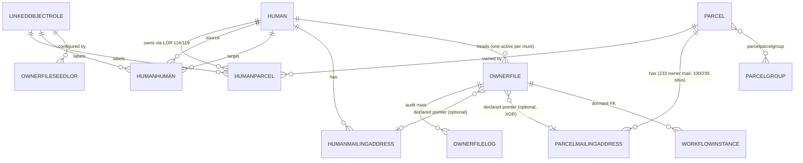

# Owner Files — Postgres Data Model

Read the [orientation page](/dev/subsystems/workflow-builder/owner-files-orientation) first. This page is
the reference for **what is in the database**: the existing link tables the facility *reads*, and the new
`workflow.*` tables it *writes*. Schema facts come from the 16-OCT-2026 schema dump
(`codeconnect/database/schemas/cogdb_local_schemaonly_16OCT26.sql`) and `dbpatch_beta104.sql`. No one
authoring this documentation ran a query against a database, so anything about *row contents* (counts,
specific ids) is quoted from ECD's recorded probe runs and is labelled as such.

## 1. Graph primer: the five words you need

The owner-file derivation is a **graph walk**. You do not need graph-theory training, only these ideas,
and you can see each one as a table.

| Graph word | Plain meaning | In CodeNforce |
|---|---|---|
| **Node** (vertex) | A thing | A row in `public.human` or `public.parcel` |
| **Edge** (link) | A connection between two nodes | A row in `public.humanparcel` (human ↔ parcel) or `public.humanhuman` (human ↔ human) |
| **Label** on an edge | What kind of connection | `linkedobjectrole_lorid` → `public.linkedobjectrole` (the **LOR**) |
| **Direction** | Which end is the "from" and which the "to" | `humanhuman.human_humanid` is the **source**, `humantarget_humanid` the **target**. The *meaning* of the direction depends on the LOR's wording |
| **Traversal / depth** | Walking from a start node along edges, counting steps | "One level": head → controlled entity → that entity's parcels |

Two more ideas appear in the [theory page](/dev/subsystems/workflow-builder/owner-files-derivation-theory):
**in-degree** (how many edges point at a node — "how many controllers does this LLC have?") and
**contraction** (collapsing an entity into the node that controls it — "folding").

**Why the edges matter more than the nodes.** A graph walk only follows edges that are *active* and
*interesting*:

- **Active** = not deactivated, not archived, and (for owner links) currently inside their validity window.
  Section 4 gives the exact predicates.
- **Interesting** = the edge's LOR is one the facility has been told to follow. That list is the **seed
  table** (section 5). The walk does **not** follow every edge a person has (cases, permits, events…); it
  follows only the seeded roles.

## 2. The nodes

### `public.human`

A person **or** a business. The two are the same kind of node.

| Column | Type | Notes for this facility |
|---|---|---|
| `humanid` | integer PK | The node id. Owner-file heads, controllers and members are all `humanid`s |
| `name` | text NOT NULL | The display name. **County names are `LAST FIRST MI`; mixed order elsewhere.** Used as the default file `title` *verbatim* (Q-V3-20) |
| `businessentity` | boolean | **Unreliable.** ECD's probe: only 3 of 1,155 Sharpsburg owners are flagged. Display-only; never used in a rule |
| `deceaseddate` | date | Raises the `HEAD_DECEASED` flag |
| `deactivatedts` | timestamptz | A deactivated human is excluded from owner reads |
| `hidereviewact90` | boolean | Deliberately **ignored** by the facility (R-22) |

### `public.parcel`

| Column | Notes |
|---|---|
| `parcelkey` | PK; the node id |
| `parcelidcnty` | The county parcel id string; shown in tables and logs |
| `muni_municode` NOT NULL | **The muni fence.** A parcel belongs to exactly one muni. Every owner read filters on it (R-21) |
| `deactivatedts` | A deactivated parcel is excluded |

A parcel's **owner** is not a column; it is an edge (next section).

## 3. The edges

### 3.1 `public.humanparcel` — "this human relates to this parcel"

| Column | Notes |
|---|---|
| `linkid` | PK. The id that audit rows record as `humanparcel_linkid` |
| `human_humanid`, `parcel_parcelkey` | The two endpoints |
| `linkedobjectrole_lorid` | The **label**. Seeded values: **116** "currently owns", **119** "owner-occupant of". Others exist (103 "owns", 120 "manager", …) but are not followed |
| `deactivatedts`, `archivedts` | Soft delete / archive. Both must be `NULL` for the edge to count |
| `validfrom`, `validto` | **Temporal validity** (defaults `now()` / `infinity`). The edge counts only while `validfrom <= now() < validto`. This is how a sale ends an ownership without deleting history (correction C-2 in the spec: earlier docs thought only mailing links were temporal) |

Indexes the facility leans on: `idx_humanparcel_parcel_active` (`parcel_parcelkey` WHERE `deactivatedts IS NULL`),
`idx_humanparcel_human_active` (`human_humanid` WHERE `deactivatedts IS NULL`),
`idx_humanparcel_role_active`, and `humanparcel_temporal_idx` (`parcel_parcelkey, validfrom, validto`).

### 3.2 `public.humanhuman` — "this human relates to that human"

| Column | Notes |
|---|---|
| `linkid` | PK; recorded in audit rows as `humanhuman_linkid` |
| `human_humanid` | The **SOURCE** end |
| `humantarget_humanid` | The **TARGET** end |
| `linkedobjectrole_lorid` | The label. Seeded control role: **2205** "Owner of Business" in ECD's production data |
| `deactivatedts`, `archivedts` | Both must be `NULL`. **There are no validity dates on this table** |

Indexes: `idx_humanhuman_human_active` and `idx_humanhuman_target_active` (each a partial index on one
endpoint WHERE `deactivatedts IS NULL`). **There is no index on the role column.** That matters for the
two-hop control query (see the [reverse lookup page](/dev/subsystems/workflow-builder/owner-files-membership-lookup)).

**HumanHuman edges are global.** Unlike a parcel, a human is not tied to one municipality, so one LLC
controlled by one person can own parcels in two towns. This is why the spec rejected putting an owner-file
foreign key on `humanhuman` (option F-3): one FK cannot belong to two municipalities' files.

#### Reading direction: the "SOURCE is ⟨role⟩ TARGET" rule

A `humanhuman` row reads as a sentence: **"`human_humanid` is *⟨role title⟩* `humantarget_humanid`."**

| LOR title wording | Sentence | Controller is the… | Seed `controllerside` |
|---|---|---|---|
| "Owner of Business" | "Wang Lang **is Owner Of** Three Rivers LLC" | **SOURCE** | `SOURCE` |
| "Owned By" (hypothetical) | "Three Rivers LLC **is Owned By** Wang Lang" | **TARGET** | `TARGET` |

The facility never guesses direction. The seed row records it (`controllerside`), and only
`OwnerFileDeriver.prepareControlEdges` applies it. Everything upstream (the SQL reads) returns raw
`(source, target)` pairs.

### 3.3 `public.linkedobjectrole` — the labels (LORs)

| Column | Notes |
|---|---|
| `lorid` | PK. The number that appears in seeds and links |
| `lorschema` | **Enum `linkedobjectroleschema`**: says *which link table the role is for*. Values include `ParcelHuman`, `HumanHuman`, `MailingaddressHuman`, `ParcelMailingaddress`, `ParcelUnitHuman`, `CECaseHuman`, … The seed inserts only accept `HumanHuman` for a control role |
| `title`, `description` | Shown in the UI and carried onto parcel and member rows ("currently owns") |
| `deactivatedts` | A deactivated LOR still joins (the seed join does not filter it) — **UNVERIFIED whether that is desired** |

**LORs are global.** There is no muni column (correction C-1). The seed table's `muni_municode` is
therefore *configuration scope*, not a property of the LOR.

Known role ids from ECD's probe P-6 (Sharpsburg era data; ids are **per-database**, so verify yours):

| lorid | Schema | Title | Used how |
|---|---|---|---|
| 116 | ParcelHuman | currently owns | seed `OWNS_PARCEL` |
| 119 | ParcelHuman | owner-occupant of | seed `OWNER_OCCUPANT` |
| 120 | ParcelHuman | manager | not followed |
| 103 | ParcelHuman | owns | not followed |
| 2205 | HumanHuman | Owner of Business | seed `CONTROLS_HUMAN`, `SOURCE` |
| 233 | ParcelMailingaddress | owner mailing address | **fixed value** `ownerfile_ownermailing_parcel_lorid` |
| 100, 235 | ParcelMailingaddress | contains / property address | **fixed value** `ownerfile_situs_parcel_lorids=100,235` (the situs) |
| 102 | MailingaddressHuman | gets mail at | not followed |

### 3.4 Address links: where mailing addresses hang

The mail-to ladder reads two link tables, both pointing at `public.mailingaddress`.

**`public.humanmailingaddress`** — the *right* home: the person's own address.
Key columns: `linkid`, `humanmailing_humanid`, `humanmailing_addressid`, `linkedobjectrole_lorid`,
`priority` (default 1), `deactivatedts`, plus `primarydesignatedts/_by_userid` (added by MAD.2 Track A;
**not used** by owner files). The ladder uses links with `deactivatedts IS NULL` **and `priority >= 0`**
("non-hidden"); `priority = 0` is a *legacy default*, never a designation.

**`public.parcelmailingaddress`** — the *legacy* home: the county scrape linked the owner's mailing
address to the **parcel**, role **233**. Key columns: `linkid`, `parcel_parcelkey`,
`mailingaddress_addressid`, `linkedobjectrole_lorid`, `priority`, `validfrom`, `validto`, `deactivatedts`.
The same table also holds the parcel's **situs** (roles 100/235). Indexes include
`idx_parcelmailingaddress_parcelkey_active` (`parcel_parcelkey, priority` WHERE `deactivatedts IS NULL`).

A `mailingaddress` row joins to `mailingstreet` and `mailingcitystatezip` to make a printable address
(see `addressColumns`/`addressJoins` in the integrator).

### 3.5 `public.parcelgroup` and `public.parcelparcelgroup` — set membership

`parcelgroup` (`parcelgroupid`, `groupname`, `muni_municode`, `deactivatedts`) is a named collection of
parcels inside one muni. `parcelparcelgroup` (`parcel_parcelkey`, `parcelgroup_groupid`, `deactivatedts`) is
the membership join. Owner files use a group **only to choose which owners to seed**: Sharpsburg's group
**"Rental Property"** (422 parcels; ECD probe P-8). The group is **never authoritative** (R-14): once a head
is known, the file lists *all* of that owner's seed-role parcels, in the group or not.

## 4. "Active edge" predicates (copy these exactly)

Ignoring any clause resurrects history (a sold parcel, an archived ownership). These are defined once in
`OwnerFileIntegrator` as `OWNER_LINK_PREDICATE` (SQL string) and in the Javadoc of the class.

```text
humanparcel ACTIVE   :  deactivatedts IS NULL AND archivedts IS NULL
                        AND validfrom <= now() AND validto > now()
humanhuman  ACTIVE   :  deactivatedts IS NULL AND archivedts IS NULL
parcel      ACTIVE   :  deactivatedts IS NULL AND muni_municode = :sessionMuni      -- R-21
human       ACTIVE   :  deactivatedts IS NULL
mailing links ACTIVE :  deactivatedts IS NULL  (parcelmailingaddress also validfrom <= now() AND validto > now())
                        (humanmailingaddress additionally priority >= 0, i.e. "not hidden")
```

The real fragment in the integrator:

```java
private static final String OWNER_LINK_PREDICATE =
        "hp.deactivatedts IS NULL AND hp.archivedts IS NULL"
        + " AND hp.validfrom <= now() AND hp.validto > now()"
        + " AND hp.linkedobjectrole_lorid = ANY(?)";
```

Note the last line: **an owner link is only an owner link if its LOR is in the seed list**. The `?` is an
integer array of the `OWNS_PARCEL` and `OWNER_OCCUPANT` seed LORs.

## 5. Seeds: `workflow.ownerfileseedlor`

The seed table is the **schema of the graph walk**: it tells the code which edge labels matter and what
they mean. It is configuration, edited **by hand (ECD's SQL)** until the Phase 2 configuration UI exists.
Nothing in Java writes to it; the only reader is `OwnerFileIntegrator.getSeedLorList`.

| Column | Type | Meaning |
|---|---|---|
| `seedlorid` | serial PK | |
| `muni_municode` | integer, nullable FK → `public.municipality` | Config **scope**: `NULL` = every muni; a value limits the row to that muni |
| `linkedobjectrole_lorid` | integer NOT NULL FK → `public.linkedobjectrole` | The role being configured. The LOR **must already exist** |
| `seedkind` | text NOT NULL | The meaning. Open-ended text, parsed to enum `OwnerFileSeedKind`. An unknown value is read as `null` and ignored with a visible setup problem |
| `controllerside` | text, nullable | `'SOURCE'` or `'TARGET'`; **required iff** `seedkind = 'CONTROLS_HUMAN'` |
| `notes` | text | Provenance |
| `createdts`, `createdby_userid` | | Lifecycle |
| `deactivatedts`, `deactivatedby_userid` | | Soft delete. `NULL` = active |

**Constraints** (from the DDL):

```sql
CONSTRAINT ownerfileseedlor_controllerside_chk
    CHECK ((seedkind = 'CONTROLS_HUMAN') = (controllerside IS NOT NULL)),
CONSTRAINT ownerfileseedlor_controllerside_vals_chk
    CHECK (controllerside IS NULL OR controllerside IN ('SOURCE', 'TARGET'))
-- plus a partial unique index over active rows:
CREATE UNIQUE INDEX ownerfileseedlor_active_uidx
    ON workflow.ownerfileseedlor (COALESCE(muni_municode, 0), linkedobjectrole_lorid, seedkind)
    WHERE deactivatedts IS NULL;
```

The first check is a Boolean equivalence: *the kind is CONTROLS_HUMAN* **if and only if** *a controller side
is given*. So a `CONTROLS_HUMAN` row without a side, or an `OWNS_PARCEL` row *with* a side, is rejected.

### The three seed kinds

| `seedkind` | Applies to LOR schema | Meaning | Effect in code |
|---|---|---|---|
| `OWNS_PARCEL` | ParcelHuman | "currently owns" | A human with this edge on a parcel is an **owner** of it |
| `OWNER_OCCUPANT` | ParcelHuman | "owner-occupant of" | Counts as ownership **and** marks the parcel `ownerOccupied` ("not rented") |
| `CONTROLS_HUMAN` | HumanHuman | "controls" | A HumanHuman edge with this LOR makes one end the **controller** of the other, per `controllerside` |

`OwnerFileSeedKind` also offers `isParcelOwnershipKind()` (true for the first two). Adding a kind needs **no
DDL** (the column is TEXT) but needs a new enum value and a branch in `classifySeeds`.

### What a seed row does *not* do

- It does **not** create a LinkedObjectRole. `INSERT … SELECT … FROM linkedobjectrole` only inserts when the
  role exists (R-32: never invent LORs).
- It does **not** change any link. Seeds are a *lens*, not data.

### The seeds patch 104 inserts (guarded)

```sql
INSERT INTO workflow.ownerfileseedlor (muni_municode, linkedobjectrole_lorid, seedkind, notes)
SELECT NULL, lor.lorid,
       CASE lor.lorid WHEN 116 THEN 'OWNS_PARCEL' ELSE 'OWNER_OCCUPANT' END,
       'seeded 15-OCT-2026 …'
  FROM public.linkedobjectrole lor
 WHERE lor.lorid IN (116, 119)
ON CONFLICT DO NOTHING;

INSERT INTO workflow.ownerfileseedlor (muni_municode, linkedobjectrole_lorid, seedkind, controllerside, notes)
SELECT NULL, lor.lorid, 'CONTROLS_HUMAN', 'SOURCE', 'ECD 15-OCT-2026 (Q-V3-1) …'
  FROM public.linkedobjectrole lor
 WHERE lor.lorid = 2205 AND lor.lorschema::text = 'HumanHuman'
ON CONFLICT DO NOTHING;
```

**Consequence for a dev database:** if your dev DB lacks LOR 2205 (production-only row), the guarded insert
silently inserts *nothing*, and the derivation reports "No control role is seeded". To fold LLCs on dev you
add a seed row for whichever HumanHuman LOR *your* database has. The step-by-step is in the
[maintainer guide](/dev/subsystems/workflow-builder/owner-files-maintainer-guide).

## 6. The folder: `workflow.ownerfile`

One row per **saved** owner file. It holds only *declared* state.

| Column | Type | Meaning |
|---|---|---|
| `ownerfileid` | serial PK | The "File number" in the UI |
| `muni_municode` | NOT NULL FK | A file belongs to exactly one muni (R-1) |
| `head_humanid` | NOT NULL FK → `public.human` | The head. The derivation walks outward from this person |
| `title` | text NOT NULL | Default = head's `human.name` verbatim at save time. Declared; a later person rename does not change it |
| `mailto_humanid` | integer FK → `public.human` | **Reserved.** No code in `OwnerFileIntegrator` reads or writes it today; the mail-to *name* override is `canonicalname` |
| `canonicalname` | text | Declared mail-to **name**. When set, it replaces the head's name on the label |
| `humanmailingaddress_linkid` | integer FK → `public.humanmailingaddress` | Declared mail-to **address pointer**, person-link flavour |
| `parcelmailingaddress_linkid` | integer FK → `public.parcelmailingaddress` | Declared mail-to address pointer, legacy-parcel-link flavour |
| `paperfileref` | text | Where the paper file physically lives |
| `notes` | text | |
| `createdts/by`, `lastupdatedts/by`, `deactivatedts/by` | | Lifecycle. `deactivatedts IS NULL` = active ("soft delete" = retire) |

```sql
CONSTRAINT ownerfile_oneaddresslink_chk
    CHECK (humanmailingaddress_linkid IS NULL OR parcelmailingaddress_linkid IS NULL)   -- at most one pointer
CREATE UNIQUE INDEX ownerfile_onefileperhead_uidx
    ON workflow.ownerfile (muni_municode, head_humanid) WHERE deactivatedts IS NULL;     -- one ACTIVE file per head per muni
CREATE INDEX ownerfile_muni_title_idx ON workflow.ownerfile (muni_municode, lower(title));
```

**Why the address is a pointer, not a copy.** Copying the address would let the file's address drift from
the data and would duplicate what the address tables already store. A pointer keeps one source of truth.
The *immutable* record of what was actually mailed is the **lock snapshot in the log** (section 7), so
deactivating the pointed-at link later cannot rewrite history.

**The partial unique index is a lock.** `ownerfile_onefileperhead_uidx` is the final arbiter when two clerks
race to create a file for the same head: the loser's `INSERT … ON CONFLICT DO NOTHING` writes nothing. A
*retired* file does not count (the index only covers `deactivatedts IS NULL`), so a head can get a new file
after the old one is retired.

**No members table, no status column.** `ownerfile` has nothing to say about parcels or LLCs, and no
"state". Both are derived (members) or read from the log (state).

## 7. The audit time series: `workflow.ownerfilelog`

Every meaningful thing that happens to a file adds a row. It is a **write-only time series**; its shape
deliberately mirrors `public.parcellog` (so the review-flagging pipeline looks familiar).

| Group | Columns | Notes |
|---|---|---|
| Identity | `ownerfilelogid` PK, `ownerfile_ownerfileid` FK, `muni_municode` FK | The log row also carries the muni for cheap muni-wide queries |
| What | `operation` text NOT NULL, `operationdescription`, `notes`, `technicaldetails`, `datapayload` | `operation` is the enum `OwnerFileLogOperation` stored as text. `datapayload` holds the **lock snapshot JSON** or the label-print manifest |
| When / who | `entrytimestamp` (default `now()`), `logginguser_userid` NOT NULL FK | |
| Cycle | `rentalcycle` text | Free text like `2026-2029`. Null for rows that are not cycle-aware |
| Soft link-focus | `human_humanid`, `parcel_parcelkey`, `humanparcel_linkid`, `humanhuman_linkid`, `humanmailingaddress_linkid`, `parcelmailingaddress_linkid` | **No foreign keys on these six, on purpose**: an audit row must outlive and must never block cleanup of the link it names |
| Review | `requiresreview` bool, `reviewreason`, `reviewflaggedts`, `reviewedby_userid`, `reviewedts`, `reviewoutcome`, `reviewnotes` | The **only** columns updated after insert |
| Triage | `errorcode`, `severity` | `INFO`/`WARNING`/`ERROR`/`CRITICAL` (`OwnerFileSeverity`) |
| Batch | `batchsessionid` uuid | Groups every row written by one run (a propose, a print run, one edit save) |

Indexes: `ownerfilelog_file_ts_idx (ownerfile_ownerfileid, entrytimestamp DESC)` (the "latest row for a
file" lookups), `ownerfilelog_cycle_op_idx (muni_municode, rentalcycle, operation)`,
`ownerfilelog_pendingreview_idx (muni_municode, entrytimestamp DESC) WHERE requiresreview AND reviewedts IS NULL`
(the pending-review list), `ownerfilelog_batch_idx`.

### The operations (`OwnerFileLogOperation`)

| Operation | Written by | Starts life awaiting review? |
|---|---|---|
| `PROPOSED` | `ownerfile_proposeFiles` | no |
| `CREATED_MANUALLY` | `ownerfile_createFile` | no |
| `HEAD_CHANGED` (+ `TITLE_CHANGED`) | `ownerfile_changeHead` | no |
| `TITLE_CHANGED`, `PAPER_REF_CHANGED`, `MAILTO_UPDATED`, `NAME_DECLARED` | `ownerfile_updateFileNames` (title, paper ref, name), `ownerfile_updateMailtoAddress` and `ownerfile_assignMailtoAddress` (address) | no |
| `PARCEL_ADDED_TO_GROUP` | `ownerfile_addParcelToGroup` | no |
| `AUDIT_SHEET_PRINTED` | **legacy, no longer written** (`ownerfile_buildAuditSheet` stopped logging 2026-10-28, pt2 item 14); old rows still read | no |
| `LABELS_PRINTED` | `ownerfile_logLabelsPrinted` (at PDF **download**, once per run) | no |
| `LOCKED_FOR_CYCLE_MAILING`, `UNLOCKED` | `ownerfile_lockForCycle`, `ownerfile_unlockForCycle` | no |
| `REVIEW_FLAGGED` | `ownerfile_flagForReview` | **yes** |
| `REVIEW_RESOLVED` | `ownerfile_resolveReview` | no |
| `RETIRED` | `ownerfile_retire` | no |
| `OWNER_CHANGED`, `MAILTO_PROMOTED`, `AUDITED_CORRECT`, `AUDITED_CHANGED`, `PACKET_MAILED`, `PACKET_RETURNED`, `ENROLLED_IN_WORKFLOW`, `NOTE` | **Defined in the enum, not written by any current method** (reserved for backlog items) | — |

**State is read from the log, never stored.** "Is file 7 locked for 2026-2029?" = the latest row among
`{LOCKED_FOR_CYCLE_MAILING, UNLOCKED}` for `(file 7, '2026-2029')`. The integrator does that with
`SELECT DISTINCT ON (ownerfile_ownerfileid, rentalcycle) … ORDER BY … entrytimestamp DESC, ownerfilelogid DESC`
(`getLockRows`, `getLatestLockOperation`).

## 8. Dormant and unused objects

| Object | State |
|---|---|
| `workflow.workflowinstance.ownerfile_ownerfileid` (nullable FK + partial index `workflowinstance_ownerfile_idx`) | Exists, **NULL everywhere**. The engine never branches on it. Reserved for the "enroll file in the rental workflow" backlog (R-27) |
| `workflow.labelcalibration` | Table and partial unique index exist (per-printer x/y offsets with a ±18 pt CHECK). **No code reads or writes it today**: the label offsets live only in the bean for the session |
| `ownerfile.mailto_humanid` | Reserved column (section 6) |

## 9. Entity-relationship diagram



`workflow.*` tables (`OWNERFILE`, `OWNERFILELOG`, `OWNERFILESEEDLOR`, `WORKFLOWINSTANCE`) have foreign keys
**into** `public`; `public` never references `workflow` (R-33). Note there is **no edge** between
`OWNERFILE` and `PARCEL` or between `OWNERFILE` and the controlled LLCs: that is the "derive, don't store"
idea drawn as an absence.

## 10. Worked data example

The Wang Lang graph from the orientation page, as rows (ids invented for illustration):

**`public.human`**

| humanid | name |
|---|---|
| 5001 | WANG LANG |
| 5002 | THREE RIVERS BARE BONES STUDIOS LLC |

**`public.parcel`** (all `muni_municode = 852`)

| parcelkey | parcelidcnty |
|---|---|
| 9001 | 0123-A-00100 |
| 9002 | 0123-A-00200 |
| 9003 | 0123-A-00300 |

**`public.humanparcel`**

| linkid | human_humanid | parcel_parcelkey | linkedobjectrole_lorid | deactivatedts | archivedts | validto |
|---|---|---|---|---|---|---|
| 70001 | 5001 | 9001 | 116 | NULL | NULL | infinity |
| 70002 | 5002 | 9002 | 116 | NULL | NULL | infinity |
| 70003 | 5002 | 9003 | 116 | NULL | NULL | infinity |

**`public.humanhuman`**

| linkid | human_humanid (SOURCE) | humantarget_humanid (TARGET) | linkedobjectrole_lorid | deactivatedts | archivedts |
|---|---|---|---|---|---|
| 80001 | 5001 | 5002 | 2205 | NULL | NULL |

**`workflow.ownerfileseedlor`**

| seedlorid | muni_municode | linkedobjectrole_lorid | seedkind | controllerside |
|---|---|---|---|---|
| 1 | NULL | 116 | OWNS_PARCEL | NULL |
| 2 | NULL | 119 | OWNER_OCCUPANT | NULL |
| 3 | NULL | 2205 | CONTROLS_HUMAN | SOURCE |

**`workflow.ownerfile`** *(after a clerk saves the proposal)*

| ownerfileid | muni_municode | head_humanid | title | canonicalname | humanmailingaddress_linkid |
|---|---|---|---|---|---|
| 1 | 852 | 5001 | WANG LANG | NULL | NULL |

**`workflow.ownerfilelog`** *(the matching audit row)*

| ownerfilelogid | ownerfile_ownerfileid | operation | logginguser_userid | human_humanid | batchsessionid |
|---|---|---|---|---|---|
| 1 | 1 | PROPOSED | 17 | 5001 | `3f1c…` |

Nothing in `workflow.ownerfile` says the file contains parcels 9001–9003 or the LLC 5002. Every time the
file is shown, the derivation re-reads rows 70001–70003 and 80001 and concludes it. If link 80001 is
deactivated tomorrow, the file loses parcels 9002 and 9003 on the next read and the LLC becomes its own
potential head — with no write to `workflow.ownerfile` at all.

## 11. Which index serves which read

| Read (integrator method) | Main predicate | Index |
|---|---|---|
| Owners of one parcel (`getParcelOwnerHumanIDs`) | `hp.parcel_parcelkey = ?` | `idx_humanparcel_parcel_active` |
| Owner links of given humans (`getOwnerLinkRowsForHumans`) | `hp.human_humanid = ANY(?)` | `idx_humanparcel_human_active` |
| Control edges around humans, hop 1 (`getControlEdgeRowsAround`, CTE `e1`) | `human_humanid = ANY(?) OR humantarget_humanid = ANY(?)` | `idx_humanhuman_human_active`, `idx_humanhuman_target_active` (bitmap-OR) |
| Control edges, hop 2 | `human_humanid IN (SELECT …) OR humantarget_humanid IN (SELECT …)` | **No guaranteed index** (ORed sub-selects). Likely a sequential scan of `humanhuman`. **UNVERIFIED**; needs `EXPLAIN` |
| Saved file by head (`getActiveOwnerFileByHead(s)`) | `muni_municode = ? AND head_humanid = ANY(?)` | `ownerfile_onefileperhead_uidx` |
| Latest log row per file (`SHELL_SELECT` lateral) | `ownerfile_ownerfileid = ? ORDER BY entrytimestamp DESC` | `ownerfilelog_file_ts_idx` |
| Pending review (`getPendingReviewRows`) | `muni_municode = ? AND requiresreview AND reviewedts IS NULL` | `ownerfilelog_pendingreview_idx` |
| Situs of a parcel (`SITUS_LATERAL`) | `pma.parcel_parcelkey = ? AND lorid = ANY(?)` | `idx_parcelmailingaddress_parcelkey_active` |
| Group membership of a parcel | `ppg.parcel_parcelkey = ?` | `idx_parcelparcelgroup_parcel_deact` |

## 12. Config that is *not* in the seed table

`WEB-INF/classes/dbFixedValueLookup.properties`:

```properties
ownerfile_ownermailing_parcel_lorid=233
ownerfile_situs_parcel_lorids=100,235
ownerfile_defaultseedgroupname=Rental Property
ownerfile_defaultrentalcycle=2026-2029
```

These are read through `getResourceBundle(Constants.DB_FIXED_VALUE_BUNDLE)` (repo rule: no hard-coded DB
ids). If a deployment's LOR ids differ, **edit this file**, not the Java.

## 13. Schema placement rule

All four new organs live in **`workflow`** (R-33): the long-term goal is to migrate *out* of `public` into
focused schemas. The only changes the patch made to existing `public`/`worldfacing` objects were ALTERs
(MAD.2 Track A audit columns, 8 `parcellogtype` enum values, two r2-06 columns) that stay with the tables
they extend. Owner files **do not use** priority or designation columns added by MAD.2.
