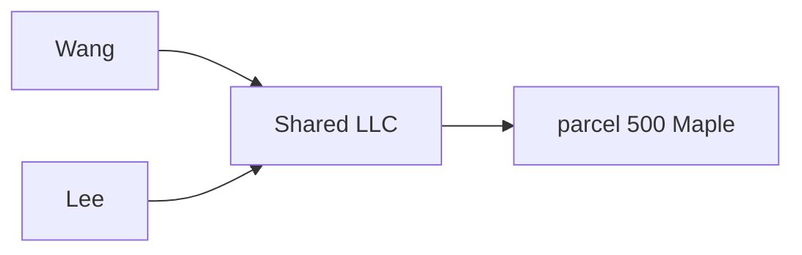

# Owner Files — Derivation Theory and the Deriver Dissected

Prerequisites: the [orientation](/dev/subsystems/workflow-builder/owner-files-orientation) and the
[data model](/dev/subsystems/workflow-builder/owner-files-data-model). If nested classes, `static`, lambdas
or `Map<Integer, LinkedHashMap<…>>` are unfamiliar, read the
[Java class design primer](/dev/subsystems/workflow-builder/owner-files-java-class-design-primer) and
[OwnerFileDeriver vs a regular coordinator](/dev/subsystems/workflow-builder/owner-files-deriver-vs-coordinator)
first; this page assumes them when it dissects the code.

This page explains **what the graph
walk computes and why it is shaped the way it is**, then reads `OwnerFileDeriver` (951 lines,
`coordinators/OwnerFileDeriver.java`) piece by piece. When you finish it you should be able to predict what
the code will do for any small graph, and say *which rule* produced the result.

## 1. Two kinds of state, one rule

Every system that shows "derived" data has to decide where the truth lives. Owner files use the oldest
rule in database design:

> **Store the facts. Compute the conclusions.**

*Facts* are things a human decided or a source reported: "this person owns this parcel" (a `humanparcel`
row), "this person controls this LLC" (a `humanhuman` row), "the clerk declared this mailing name"
(`ownerfile.canonicalname`). *Conclusions* are things that follow from the facts: "so this parcel belongs
in that person's folder."

If you store a conclusion, you have created a **cache**. The two classic failures of a cache are:

1. **Staleness**: the fact changes and the cache does not. (A parcel is sold; the file still lists it.)
2. **Dual writes**: every code path that changes a fact must remember to update the cache. (Every place that
   edits a link would need to maintain a member table; one forgotten place corrupts it silently.)

The spec records this as the "Why no member table" argument (§V3.3.3; rulings R-8, R-25). The cost of the
rule is that conclusions are **recomputed**, which is why the derivation is written as a *fast, set-based,
read-only* operation (and why Phase 17 evaluates cost so carefully; see the
[reverse lookup page](/dev/subsystems/workflow-builder/owner-files-membership-lookup)).

## 2. The graph, stated precisely

Fix one municipality *M* (the **muni fence**, R-21). Define:

- **H** — the set of humans (nodes of one kind).
- **P** — the set of active parcels in *M* (nodes of the other kind).
- **Own** ⊆ H × P — the active `humanparcel` edges whose LOR is a seeded ownership role (`OWNS_PARCEL` or
  `OWNER_OCCUPANT`). Write *own(h, p)*.
- **Ctl** ⊆ H × H — the **controller → controlled** relation, obtained by taking each active `humanhuman`
  edge whose LOR is a `CONTROLS_HUMAN` seed and **orienting** it using `controllerside`. Write *ctl(c, e)* for
  "*c* controls *e*".

Two functions fall out:

- **owners(p)** = { h : own(h, p) } — who owns a parcel.
- **controllers(e)** = { c : ctl(c, e) } — who controls an entity. Its size is the **in-degree** of *e* in
  the control graph.

Everything in the facility is built from `owners`, `controllers`, and a set of **heads** (the people who get
a folder).

### Orientation normalisation

`humanhuman` stores `(human_humanid, humantarget_humanid)` = (SOURCE, TARGET). A role wording decides which
end controls. The seed row's `controllerside` captures that wording once:

| `controllerside` | `ctl(c, e)` is built as |
|---|---|
| `SOURCE` | c = `human_humanid`, e = `humantarget_humanid` |
| `TARGET` | c = `humantarget_humanid`, e = `human_humanid` |

This normalisation is the **only** place direction is interpreted. SQL returns raw edges; the pure deriver
does the orientation. (If you ever see direction logic in SQL, it is a bug in the layering.)

## 3. The rules

The derivation is a small set of rules, each ratified by ECD. Learn their *names*; the code and flags use
them.

| # | Rule | Statement | Spec |
|---|---|---|---|
| **H1** | **Heads** | In a group-seeded run, the heads are the owners of the chosen group's parcels (plus controllers of those owners, rule F1). In a saved-files run, the heads are exactly the saved files' heads | R-14, Q-V3-23 |
| **F1** | **Fold on sole controller** | If *e* has **exactly one** controller *c*, *e* is **folded into** *c*'s file and *c* heads a file (even if *c* owns nothing in the group) | R-18, §V3.3.3 |
| **F2** | **No merge on 2+ controllers** | If *e* has **two or more** controllers, *e* is folded into **no** file. It heads its own, flagged `MULTIPLE_CONTROLLERS` | Q-V3-3, R-19 |
| **L1** | **One level** | A controller that is itself controlled is **not** itself folded; it heads its own file and is flagged `DEEP_CHAIN_IGNORED`. The walk never recurses | R-18 |
| **S1** | **Saved heads stay heads** | A person with a saved file always heads that file in a saved-files read, whatever the graph says | §V3.3.3 step 4 |
| **C1** | **A file lists everything its owner owns** | A file's parcels = parcels of the head **∪** parcels of each folded member, whether or not they are in the seed group | Q-V3-23 |
| **M1** | **Muni fence** | Only parcels in the session muni are ever followed | R-21 |
| **N1** | **Non-overlap is a flag, not a rule** | A parcel in two files, or a person in two files, is *shown* and flagged, never hidden | Q-V3-3, Q-V17-2 |

Why the odd-looking **"exactly one"** in F1? Because of what happens with two:



If both Wang and Lee have files and the LLC folds into *both*, parcel 500 appears in two folders; the same
packet is mailed twice. If the LLC folds into *neither*, an owner's parcel is missing from every folder.
Rather than guess, rule F2 makes the machine **refuse** and puts a warning on both files, so a clerk decides
(R-19: "clerk decides head selection"). The sole-controller rule is what keeps the folding a **partition**:
every entity ends in at most one folder.

Why **one level** (L1)? Three reasons the spec gives: it bounds the work (no recursion, no cycle handling),
it matches how Sharpsburg actually owns property (person → LLC → parcels), and deeper chains in real data
are ambiguous. The cost is that depth ≥ 2 is *ignored*, with at most an INFO flag (see the gap in §10).

## 4. Worked examples

Every example uses the **same notation**: `own(Alice → P1)` is a `humanparcel` edge with a seeded
ownership LOR; `ctl(Wang ⇒ LLC)` is an oriented control edge. "Group" means the chosen seed parcel group.

### Example A: a plain owner

```text
own(Alice → P1)           group = { P1 }
```

Heads: Alice (owner of a group parcel). No control edges. **Result:** one file, head Alice, parcels {P1}.
Flags: none from the graph (the mail-to ladder may add some).

### Example B: a person who owns through an LLC (the standard case)

```text
own(Wang → P1)            ctl(Wang ⇒ LLC)
own(LLC → P2), own(LLC → P3)          group = { P2, P3 }     ← Wang owns nothing in the group
```

1. Seed-group owners = { LLC } (P2 and P3 are in the group).
2. `soleController(LLC)` = Wang → **Wang becomes a head** (rule F1: the controller heads even though he owns
   nothing in the group) and **LLC is folded into Wang**.
3. File: head **Wang**; parcels P1 (owned by head), P2 and P3 (owned by member LLC). By rule C1, P1 appears
   although it is not in the group.

### Example C: an entity with two controllers

```text
ctl(Wang ⇒ LLC)   ctl(Lee ⇒ LLC)        own(LLC → P2)       group = { P2 }
```

`controllers(LLC) = {Wang, Lee}`, size 2 → rule F2. `soleController(LLC)` is `null`, so **LLC is a head** of
its own file (parcel P2). That file is flagged `MULTIPLE_CONTROLLERS` ("Controlled by: Wang (control link …);
Lee (control link …)"). If Wang or Lee also head files, **their** files get `CONTROLLED_ENTITY_NOT_FOLDED`
("controls an entity it does not hold").

### Example D: a chain, and why the walk stops

```text
ctl(Wang ⇒ LLC1)   ctl(LLC1 ⇒ LLC2)      own(LLC2 → P9)        group = { P9 }
```

**Group-seeded run.** Seed-group owners = { LLC2 }. `soleController(LLC2)` = LLC1 → LLC1 becomes a head and
LLC2 folds into it. LLC1 itself has a controller (Wang), so its file is flagged `DEEP_CHAIN_IGNORED`.
**Wang is not a head** (he owns nothing in the group and has no saved file): the depth-2 chain stops at LLC1.

**Saved-files run with Wang saved.** Heads = { Wang }. LLC1 (if it owns parcels) folds into Wang. LLC2's sole
controller is LLC1, which is **not a head**, so LLC2 is folded into nothing: **its parcel P9 appears in no
file**. *By my reading of `raiseControlFlags`/`raiseSharedControlFlag`, no flag is raised on Wang's file for
this — the depth-2 entity is silently left out.* This is a real limitation of "one level, ignored with an
INFO flag"; the flag only fires when the middle node heads a file. **UNVERIFIED by execution;** worth a
browser check with real data.

### Example E: mutual control

```text
ctl(A ⇒ B)   ctl(B ⇒ A)      own(A → P1)   own(B → P2)    group = { P1, P2 }
```

`soleController(A) = B`, `soleController(B) = A`, so both are in `controllerHeads`; the fold test
`!controllerHeads.contains(owner)` is false for each. **Both head their own file.** The two-person cycle
cannot loop because the code never recurses.

### Example F: co-owned parcel and duplicate people

```text
own(Alice → P7)   own(Bob → P7)       group = { P7 }
```

Two heads (Alice, Bob). Both files list P7 → `PARCEL_IN_MULTIPLE_FILES` on both. Real data has this for
**3 parcels** in Sharpsburg (probe P-9). A similar problem: one real owner stored as several `human` rows
(CRESTA ×3, DRD ×2…). Each row heads its own file; the cross-file flag `SAME_MAILTO_AS_OTHER_FILE` flags
files that resolve to the same address so a clerk merges true duplicates (with the person merge tool) and
re-derives. **Same address does not mean same owner** (probe P-13: ~17 true duplicates, the rest distinct
LLCs at one address), so the flag text says "same address", never "duplicate".

### Example G: owner-occupied

```text
own(Carol → P8, role 116)    own(Carol → P9, role 119)
```

Both count as ownership (both are seeded). P9's row gets `ownerOccupied = true` ("not rented"). If *both* roles
sit on one parcel for one human, the deriver **merges them into one ownership** (key `ownerHumanID:parcelKey`)
and marks it owner-occupied.

## 5. The data structures inside the deriver

The deriver receives **flat row lists** (the results of bulk SQL reads) and builds **in-memory indexes** on
them. This is the same thing a database does when it executes a hash join; doing it in memory lets the SQL
stay simple (a handful of set-based queries, **not one query per file** — which would be the classic **N+1**
problem).

### `Input` — what the integrator hands over

(`OwnerFileDeriver.Input`; every field is a plain public field the coordinator fills.)

| Field | Origin | Content |
|---|---|---|
| `ownerLinks` (D1) | `getOwnerLinkRows…` | One `OwnerFileParcelRow` per active seed-role owner link: owner human, parcel, role, `inSeedGroup`, situs |
| `controlEdges` (D2) | `getControlEdgeRows…` | Raw `OwnerFileControlEdgeRow` (link id, role, source id, target id), **not** oriented |
| `humans` (D6) | `getHumanRefs` | `humanid → Human` skeleton (name, business flag, deceased date) |
| `humanAddressLinks` (D3a) | `getHumanMailingAddressRows` | Active, non-hidden human mailing links |
| `parcelOwnerMailingLinks` (D3b) | `getParcelMailingAddressRows` | Active role-233 parcel links |
| `declaredHumanLinks` / `declaredParcelLinks` (D3c/d) | `getDeclared…LinkRows` | The links saved files *point at*, active or not |
| `existingFiles` (D4) | `getActiveOwnerFile…` | Saved files as **shells** |
| `ownerlessGroupParcels` (D5) | `getOwnerlessGroupParcelRows` | Group parcels with no owner link |
| `lockRows` (D7) | `getLockRows` | Latest lock/unlock row per file+cycle |
| `occupantLorIDs`, `controlSideByLorID`, `roleTitleByLorID` | `classifySeeds` | Seed meanings |
| `headsFromSeedGroup`, `forcedHeadIDs` | the coordinator | Run mode (next section) |

### `DeriveContext` — the working indexes

```java
private static class DeriveContext {
    final Input in;
    final Map<Integer, List<OwnerFileParcelRow>> parcelRowsByOwner = new LinkedHashMap<>();
    final Map<Integer, Set<Integer>> ownersByParcel = new HashMap<>();
    final Map<Integer, LinkedHashMap<Integer, OwnerFileControlEdgeRow>> controllersOf = new HashMap<>();
    final Set<Integer> seedGroupOwners = new LinkedHashSet<>();
    final Set<Integer> heads = new LinkedHashSet<>();
    final Map<Integer, Integer> foldedInto = new LinkedHashMap<>();
    ...
    final Map<Integer, List<Integer>> controlledBy = new HashMap<>();
}
```

Read each map as "**key → what it answers**":

| Map | Key → value | Answers |
|---|---|---|
| `parcelRowsByOwner` | owner humanid → their parcel rows | "What does this human own?" (used to build a file's parcel list) |
| `ownersByParcel` | parcelkey → set of owner ids | "Who owns this parcel?" (co-ownership statistics) |
| `controllersOf` | entity id → (controller id → the edge) | "Who controls this entity?" Its **size** is the in-degree. This is the sole-controller test |
| `controlledBy` | controller id → list of entity ids | "What does this person control?" (for the `CONTROLLED_ENTITY_NOT_FOLDED` flag) |
| `seedGroupOwners` | set of human ids | H1: owners of group parcels (empty in a saved-files run) |
| `heads` | set of head ids | The final list of folders to assemble |
| `foldedInto` | entity id → head id | The fold decisions made by F1/L1 |

`LinkedHashMap`/`LinkedHashSet` are used so iteration order is **deterministic** (input order), which keeps
output stable between runs.

### Three run modes: one algorithm

The same `derive(Input)` serves three callers, distinguished only by `Input` fields:

| Mode | Caller | `headsFromSeedGroup` | Heads come from | Extra reads |
|---|---|---|---|---|
| **Group-seeded** | `ownerfile_deriveAll` | `true` | Owners of the chosen group's parcels (+ their controllers) + saved heads | Muni-wide owner links and control edges |
| **Saved-files** | `ownerfile_deriveSaved` | `false` | Saved heads only | Scoped to the saved heads |
| **Single head graph** | `ownerfile_getLinkGraph` | `false` | The saved file's head, or `forcedHeadIDs` if the person has no file (a **preview**) | Scoped to one head |
| *(Reverse lookup)* | `deriveMembership` (private) | `false` | The candidate saved files | Scoped, no addresses |

## 6. `derive()` — the main loop

```java
public OwnerFileDerivation derive(Input in) {
    DeriveContext ctx = new DeriveContext(in);
    for (OwnerFileHeavy shell : in.existingFiles) {
        ctx.existingByHead.putIfAbsent(shell.getHead().getHumanID(), shell);
    }
    for (OwnerFileLockRow lock : in.lockRows) {
        ctx.lockOpsByFile.computeIfAbsent(lock.getOwnerFileID(), k -> new HashMap<>())
                .put(lock.getRentalCycle(), lock.getOperation());
    }
    prepareOwnerParcels(ctx);
    prepareControlEdges(ctx);
    prepareAddresses(ctx);
    chooseHeadsAndMembers(ctx);

    List<OwnerFileHeavy> files = new ArrayList<>();
    for (Integer headID : ctx.heads) {
        files.add(assembleFile(ctx, headID));
    }
    files.sort(Comparator
            .comparing((OwnerFileHeavy f) -> lower(f.getTitle()))
            .thenComparingInt(f -> f.getHead().getHumanID()));

    flagFilesSharingAMailtoAddress(files);
    flagParcelsInMultipleFiles(files);
    flagHumansInMultipleFiles(files);
    int seq = 1;
    for (OwnerFileHeavy f : files) {
        f.setProposalSeq(seq++);
        finishFlags(f);
    }
    // … result, summary, ownerless parcels
}
```

The function is a **pipeline of four phases**:

1. **Index** (`prepare…`): turn flat lists into the maps above.
2. **Decide** (`chooseHeadsAndMembers`): fill `heads` and `foldedInto`. *This is where rules H1, F1, F2, L1, S1
   are applied.*
3. **Assemble** (`assembleFile`, once per head): build each `OwnerFileHeavy`; per-file flags and mail-to.
4. **Cross-file pass**: flags that need the *whole list* of files.

The result is sorted by `lower(title)`; unsaved files get a provisional `proposalSeq` (1, 2, …) in that
order, shown as "unsaved N".

## 7. Dissection: `prepareControlEdges`

```java
private void prepareControlEdges(DeriveContext ctx) {
    for (OwnerFileControlEdgeRow e : ctx.in.controlEdges) {
        OwnerFileControllerSide side = ctx.in.controlSideByLorID.get(e.getLinkRoleID());
        if (side == null) {
            continue;
        }
        int controller = side == OwnerFileControllerSide.SOURCE ? e.getSourceHumanID() : e.getTargetHumanID();
        int controlled = side == OwnerFileControllerSide.SOURCE ? e.getTargetHumanID() : e.getSourceHumanID();
        if (controller == controlled) {
            continue;
        }
        ctx.controllersOf.computeIfAbsent(controlled, k -> new LinkedHashMap<>()).putIfAbsent(controller, e);
        List<Integer> held = ctx.controlledBy.computeIfAbsent(controller, k -> new ArrayList<>());
        if (!held.contains(controlled)) {
            held.add(controlled);
        }
    }
}
```

Read it as the code form of "orientation normalisation" (section 2):

- **`side == null` → skip.** The edge's LOR has no seed row (or the seed had no side). It is not a control
  edge for us.
- **`controller` / `controlled`** are assigned by the ternary pair. *This is the only place `controllerside`
  is consulted.*
- **`controller == controlled` → skip.** A self-link is ignored (it would otherwise count as an entity
  controlling itself).
- **`controllersOf[controlled][controller] = e`, using `putIfAbsent`.** The inner map is keyed by the
  **controller id**, so two parallel links between the same pair collapse into **one controller**. Its
  `.size()` is therefore the in-degree *counted in distinct controllers*, exactly what F1/F2 need.
- **`controlledBy`** is the reverse index, with a `contains` check to avoid duplicates.

## 8. Dissection: `chooseHeadsAndMembers` (the heart)

```java
private void chooseHeadsAndMembers(DeriveContext ctx) {
    // controllers of seed-group owners that have exactly one controller: these head files
    Set<Integer> controllerHeads = new LinkedHashSet<>();
    for (Integer owner : ctx.seedGroupOwners) {
        Integer only = soleController(ctx, owner);
        if (only != null) {
            controllerHeads.add(only);
        }
    }
    for (Integer owner : ctx.seedGroupOwners) {
        Integer only = soleController(ctx, owner);
        if (only != null && !controllerHeads.contains(owner)) {
            ctx.foldedInto.put(owner, only);
        } else {
            ctx.heads.add(owner);
        }
    }
    ctx.heads.addAll(controllerHeads);
    // a saved file keeps its head, whether or not the head is derived from the group today
    ctx.heads.addAll(ctx.existingByHead.keySet());
    ctx.heads.addAll(ctx.in.forcedHeadIDs);

    // owners outside the seed group fold into a head that controls them (the graph is followed to every owned parcel)
    for (Integer owner : ctx.parcelRowsByOwner.keySet()) {
        if (ctx.seedGroupOwners.contains(owner) || ctx.heads.contains(owner)) {
            continue;
        }
        Integer only = soleController(ctx, owner);
        if (only != null && ctx.heads.contains(only)) {
            ctx.foldedInto.put(owner, only);
        }
    }
}

/** @return the one controller of the human, or null when it has none or 2+ */
private Integer soleController(DeriveContext ctx, int humanID) {
    Map<Integer, OwnerFileControlEdgeRow> controllers = ctx.controllersOf.get(humanID);
    if (controllers != null && controllers.size() == 1) {
        return controllers.keySet().iterator().next();
    }
    return null;
}
```

Walk it in four **blocks**:

**Block 1: collect the controllers that will become heads.** For each group owner with a sole controller,
record the controller. (F1.)

**Block 2: fold or head.** For each group owner:
- It has a sole controller **and is not itself one of the controllers collected in block 1** → **fold** it
  into that controller. (F1 *and* L1: if the owner is itself a controller of another group owner, it must
  head its own file, not be folded; that is what `!controllerHeads.contains(owner)` encodes.)
- Otherwise (no controller, 2+ controllers, **or** it is itself a collected controller) → it **heads its
  own file**. (F2 and L1.)

**Block 3: add the other heads.** All collected controllers, then every saved file's head (S1), then any
forced heads. `LinkedHashSet` removes duplicates.

**Block 4: sweep the non-group owners.** Anyone who owns a parcel but is not a group owner and not already a
head is folded into their sole controller **only if that controller is a head**. This is what makes
"a file lists **all** of its owner's parcels" (C1) work: an LLC outside the group still folds in under the
head that controls it. Note the guard `ctx.heads.contains(only)`: an owner whose sole controller is *not* a
head (the depth-2 case in Example D) is **left unfolded**.

Three consequences you can now derive yourself:

1. **A saved head can be both head and folded** in a group-seeded run: block 2 can fold a saved head into
   its sole controller, and block 3 then *also* makes it a head. The cross-file pass
   (`flagHumansInMultipleFiles`) then raises `HUMAN_IN_MULTIPLE_FILES` on both files so a clerk sees it.
   In a **saved-files** run `seedGroupOwners` is empty, block 2 does not run, and block 4's
   `ctx.heads.contains(owner)` test *skips* saved heads — so a saved head is **protected from folding**.
2. **The reverse lookup depends on that protection.** If you ask "is person X in a file?" you must hand
   the deriver X's *own shell* too, or X could be wrongly folded under their controller. See
   [the lookup page](/dev/subsystems/workflow-builder/owner-files-membership-lookup).
3. **Folding is decided before any file is built.** `assembleFile` only *reads* `foldedInto`.

## 9. Dissection: `assembleFile`

```java
private OwnerFileHeavy assembleFile(DeriveContext ctx, int headID) {
    OwnerFileHeavy f = new OwnerFileHeavy();
    f.setMuniCode(ctx.in.muniCode);
    Human head = ctx.in.humans.get(headID);
    ...
    f.setHead(head);
    f.setTitle(head.getName());
    OwnerFileHeavy saved = ctx.existingByHead.get(headID);
    if (saved != null) {
        attachSavedFile(f, saved);       // declared state wins: saved title, notes, paper ref, pointers...
        f.setLatestLogOperationByCycle(new HashMap<>(ctx.lockOpsByFile.getOrDefault(saved.getOwnerFileID(), Collections.emptyMap())));
    }

    List<OwnerFileParcelRow> parcelRows = new ArrayList<>();
    // each file gets its own copies: a saved head can also be folded into another file, and the per-file flags must not collide
    for (OwnerFileParcelRow r : ctx.parcelRowsByOwner.getOrDefault(headID, Collections.emptyList())) {
        OwnerFileParcelRow mine = new OwnerFileParcelRow(r);
        mine.setOwnedByHead(true);
        parcelRows.add(mine);
    }
    List<OwnerFileMemberRow> members = new ArrayList<>();
    for (Map.Entry<Integer, Integer> fold : ctx.foldedInto.entrySet()) {
        if (fold.getValue() != headID) {
            continue;
        }
        int memberID = fold.getKey();
        OwnerFileControlEdgeRow edge = ctx.controllersOf.get(memberID).get(headID);
        List<OwnerFileParcelRow> memberParcels = ctx.parcelRowsByOwner.getOrDefault(memberID, Collections.emptyList());
        OwnerFileMemberRow m = new OwnerFileMemberRow();
        ...
        m.setControlLinkID(edge.getLinkID());                        // which humanhuman row justifies the fold
        m.setParcelCount(distinctParcelKeys(memberParcels).size());
        members.add(m);
        for (OwnerFileParcelRow r : memberParcels) {
            OwnerFileParcelRow mine = new OwnerFileParcelRow(r);
            mine.setOwnedByHead(false);
            parcelRows.add(mine);
            m.getParcelRows().add(mine);
        }
    }
    ...
    raiseControlFlags(ctx, f, headID);
    raiseSharedControlFlag(ctx, f, headID);
    raiseHeadFlags(f, head);
    if (saved != null && f.getParcelCount() == 0) {
        raise(f, OwnerFileFlag.NO_CURRENT_PARCELS, null);
    }
    resolveMailto(ctx, f, head);
    raiseAddressFlags(f);
    return f;
}
```

What to notice:

- **Declared state wins** over derived (`attachSavedFile`), but the **parcels and members are always
  re-derived**, so a saved file's content is never stale.
- **Per-file copies of parcel rows** (`new OwnerFileParcelRow(r)`). A saved head who is also folded into
  another file would otherwise share row objects across two files, and a flag set for one would appear on
  the other. (This was a bug the build found and fixed.)
- **`ownedByHead`** distinguishes "the head owns this" from "an entity the head controls owns this".
  Display and the reverse lookup both use it (`PARCEL_OWNER_IS_HEAD` vs `…_FOLDED_ENTITY`).
- **`edge = controllersOf.get(memberID).get(headID)`** retrieves the exact control link that justifies the
  fold, so the UI and the audit log can *name the link a clerk would fix*.
- **Performance note.** The `for … foldedInto.entrySet()` loop runs **once per head** and skips non-matching
  entries, so assembly costs O(heads × folded entities). For a muni-wide derivation of a few hundred heads
  this is trivial; inverting the map would make it linear, but there is no need today.

## 10. The mail-to ladder

The file's **mailing name** and **address** are *resolved* every read. The ladder is ECD's own logic
(Q-V3-19), adopted unchanged: **no `priority`, no "designation"**.

### Name

```text
mailtoName = canonicalname (if declared and non-blank) else head.name
```

### Address: first rung that yields an answer wins

| Rung | Source | Provenance (`OwnerFileMailtoProvenance`) | Flag |
|---|---|---|---|
| 1 | **Declared** pointer to an **active** human mailing link | `DECLARED` | `DECLARED_DIFFERS_FROM_DERIVED` (INFO, only if the data had exactly one different answer) |
| 1 | Declared pointer to an **active** legacy parcel link | `DECLARED_LEGACY_PARCEL` | `LEGACY_MAILTO_POINTER` (INFO) |
| 1x | Declared pointer exists but its link was **deactivated** | falls through | `DECLARED_LINK_DEACTIVATED` (WARNING) |
| 2 | Head has **exactly one distinct address** across active, non-hidden human links | `HEAD_SINGLE_ADDRESS` | — |
| 3 | Head has **2+ distinct addresses** | `HEAD_AMBIGUOUS` (proposal = most recently updated) | `MAILTO_HEAD_ADDRESSES_DIFFER` |
| 4 | Head has none: pool role-233 parcel links across the **file's** parcels (head + folded); exactly one distinct address | `LEGACY_233_SINGLE` | `MAILTO_FROM_LEGACY_PARCEL_LINK` |
| 5 | Same pool, 2+ distinct | `LEGACY_233_AMBIGUOUS` (proposal = most frequent; a **tie proposes nothing**) | `MAILTO_LEGACY_CONFLICT` |
| — | Nothing | `NONE` | `NO_MAILTO_ADDRESS` (ERROR; blocks the label) |

"Distinct" means distinct `mailingaddress.addressid`: several *links* to one address count as one.

### The code, shape only

```java
private void resolveMailto(DeriveContext ctx, OwnerFileHeavy f, Human head) {
    OwnerFileMailtoResolution mt = f.getMailto();
    int flagsBeforeLadder = f.getFlagsRaised().size();
    resolveDerivedMailto(ctx, f, head);                    // rungs 2 to 5 (the data's answer)
    OwnerFileMailtoProvenance derivedProvenance = mt.getProvenance();
    mt.setDerivedAddress(mt.getAddress());
    ...
    if (declared != null) {
        // the clerk has settled it, so the ladder's ambiguity and no-address flags no longer apply
        List<OwnerFileFlagRaised> raised = f.getFlagsRaised();
        while (raised.size() > flagsBeforeLadder) {
            raised.remove(raised.size() - 1);              // erase flags the ladder just raised
        }
        mt.setProvenance(humanPointer ? DECLARED : DECLARED_LEGACY_PARCEL);
        mt.setAddress(declared);
        ...
    }
    if (f.getCanonicalName() != null && !f.getCanonicalName().isBlank()) {
        mt.setMailtoName(f.getCanonicalName().trim());
    }
    buildAddressCandidates(ctx, f, head, declared, humanPointer);
}
```

The **order of operations** is the important design: the *data ladder runs first* and fills
`derivedAddress`; then a clerk's declaration is *laid over it*. That is why `DECLARED_DIFFERS_FROM_DERIVED`
can be computed ("what the data would have said") and why a deactivated declaration cleanly falls back. The
`flagsBeforeLadder` snapshot lets a valid declaration **rewind** the ambiguity flags: once the clerk picked
among several addresses, `MAILTO_HEAD_ADDRESSES_DIFFER` would be noise.

**Candidate addresses** (`buildAddressCandidates`) are every address a clerk may pick: the declared link, the
head's own links, each folded entity's links, then the legacy role-233 links on the file's parcels; one entry
per distinct address. Each carries a **key** (`"H" + humanLinkId` or `"P" + parcelLinkId`) so a pick points
at exactly one link. The edit dialog only lets a clerk pick from this list.

## 11. Flags

Flags are **derived on every read and never stored** (`OwnerFileFlag`, 19 values; each has a severity from the
ascending enum `OwnerFileSeverity`: `INFO` < `WARNING` < `ERROR` < `CRITICAL`; no flag currently uses
`CRITICAL`). Only a *log row with `requiresreview`* persists review state.

Two groups by *when* they can be raised:

| Group | Needs | Examples |
|---|---|---|
| **Per-file** (raised in `assembleFile`) | Only that file's own data | `NO_MAILTO_ADDRESS`, `MAILTO_*`, `MULTIPLE_CONTROLLERS`, `DEEP_CHAIN_IGNORED`, `CONTROLLED_ENTITY_NOT_FOLDED`, `HEAD_DECEASED`, `HEAD_IS_BUSINESS_ENTITY`, `ADDRESS_NOT_VERIFIED`, `ADDRESS_PO_BOX`, `MAILTO_AT_OWNED_PARCEL`, `NO_CURRENT_PARCELS`, the declared-address flags |
| **Cross-file** (raised after assembly, over the whole list) | Every file at once | `SAME_MAILTO_AS_OTHER_FILE`, `PARCEL_IN_MULTIPLE_FILES`, `HUMAN_IN_MULTIPLE_FILES` |

**Consequence:** the single-head graph read (`ownerfile_getLinkGraph`) and the reverse lookup run on **one or a
few** files, so they **cannot** raise the cross-file flags. The saved-files list can. A flag you expect on
the "linked objects" dialog but see only in the table is not a bug.

`raise()` is idempotent per flag: a file never carries the same flag twice (`if (!f.hasFlag(flag))`).
`finishFlags` orders a file's flags worst-severity-first and records `highestSeverity`.

The semantics of each flag are in the [data model](/dev/subsystems/workflow-builder/owner-files-data-model)
and the spec §V3.4.3. The ones that need **parent data** to even exist (`LEGACY_MAILTO_POINTER`,
`DECLARED_LINK_DEACTIVATED`, `DECLARED_DIFFERS_FROM_DERIVED`, `NO_CURRENT_PARCELS`,
`HUMAN_IN_MULTIPLE_FILES`) can only appear once a file is saved.

## 12. Pure core, impure shell

`OwnerFileDeriver` has **no CDI annotations, no JDBC, no `FacesContext`, no clock but `LocalDateTime.now()`
for a timestamp**. Everything it needs comes in via `Input`; everything it produces is in the returned
`OwnerFileDerivation`. The coordinator holds one shared instance (`private final OwnerFileDeriver deriver`)
because the class is **stateless**: all working state is in the per-call `DeriveContext`. (Why a nested
`static` context class, why every helper takes `ctx`, and how this differs from a regular coordinator like
`PropertyCoordinator` are covered in
[OwnerFileDeriver vs a regular coordinator](/dev/subsystems/workflow-builder/owner-files-deriver-vs-coordinator);
the Java mechanics are in the [class design primer](/dev/subsystems/workflow-builder/owner-files-java-class-design-primer).)

> **A precision on "pure".** The deriver is free of I/O and container dependencies, and deterministic, but it
> **annotates the row objects it is handed** (`setOwnerName`, `setOwnerOccupied`, `setLinkRoleTitle`,
> `setOneLineText` on the input `ownerLinks` and address rows). The annotations are recomputed identically on
> each run, and every file's parcel rows are **copies**, so derived flags never leak between files. But do
> **not** hand the same row objects to two concurrent `derive` calls. Details in
> [deriver vs coordinator §3.7](/dev/subsystems/workflow-builder/owner-files-deriver-vs-coordinator).

Why this matters to you:

- **You can reason about it as a function.** Same `Input` → same output. When a clerk reports a surprising
  file, the question is always "what rows went in?", never "what hidden state was the bean in?".
- **It is the single source of folding rules.** The reverse lookup, the saved-files list, the group-seeded
  proposals, the label run, the CSV and the audit page all route through it. A rule change here changes all
  of them at once. This is deliberate (rule 6 on the orientation page).
- **It can be exercised without a server.** Decision R-34 says there are **no automated tests** for this
  facility (JSF session seeding makes them impractical). The build logs record that the deriver was
  checked with throwaway harnesses in `/tmp` (12 hand-built scenarios, later 91 checks over a fake
  integrator), **never committed**. Because the class is pure, a scratch harness only needs a hand-built
  `Input`, a call to `derive`, and a look at the returned `files`: no JSF and no database.

## 13. A mental checklist for reading any derivation result

When a derived file looks wrong, ask in this order:

1. **Are the right seeds active?** (`workflow.ownerfileseedlor`; setup problems appear at the top of the
   panel.)
2. **Is the owner link active?** (not deactivated, not archived, inside `validfrom..validto`, role seeded,
   parcel active and in the muni.)
3. **Is the control edge active and in the right direction?** (`controllerside` matches the LOR wording.)
4. **How many controllers does the entity have?** (2+ means F2; look for `MULTIPLE_CONTROLLERS` and
   `CONTROLLED_ENTITY_NOT_FOLDED`.)
5. **Is the controller a head?** (In a saved-files run only saved heads fold things; Example D.)
6. **Is the entity at depth 2?** (L1: silently dropped.)
7. **Is the data duplicated?** (several `human` rows for one owner → several files.)

The [maintainer guide](/dev/subsystems/workflow-builder/owner-files-maintainer-guide) turns this into a
troubleshooting table.
