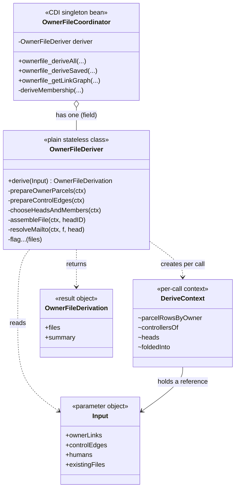
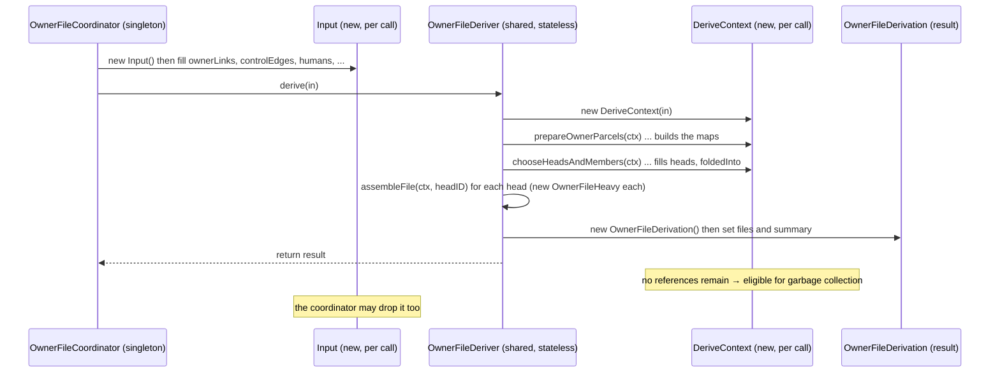
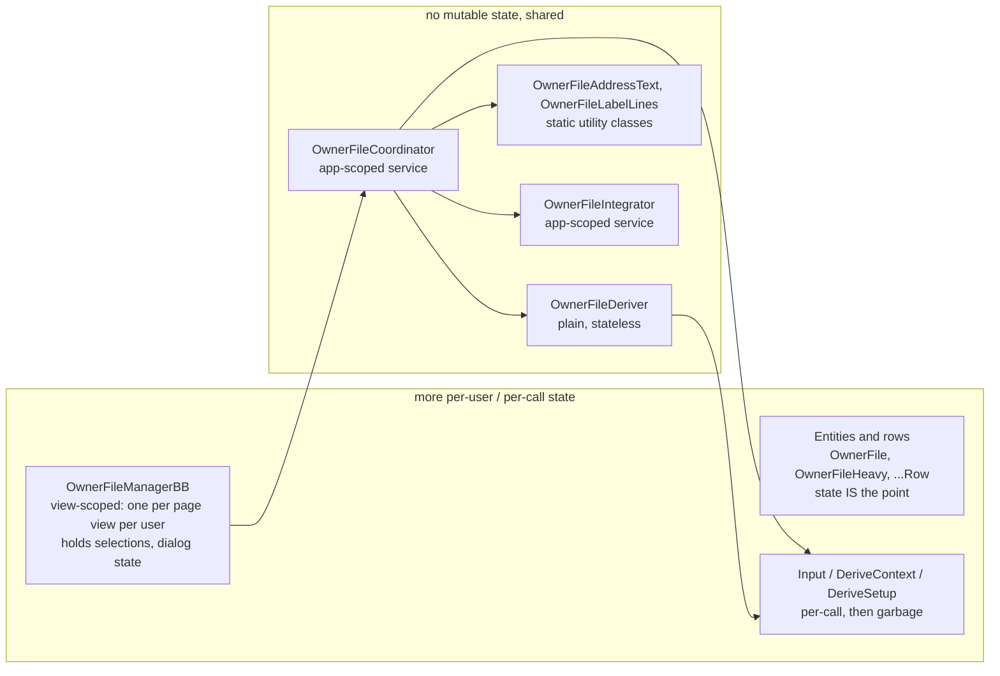
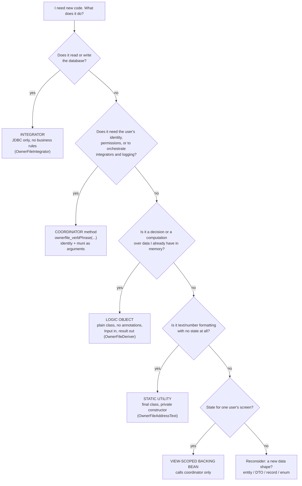

# Owner Files — OwnerFileDeriver vs a Regular Coordinator

Prerequisite: the [Java class design primer](/dev/subsystems/workflow-builder/owner-files-java-class-design-primer)
(nested classes, `static`, `final`, enums, copying). This page answers a specific question: *`OwnerFileDeriver`
feels like a different kind of class from the coordinators I know. How, and why?*

## 1. The short answer

CodeNforce has **two species of class**, and they obey different rules.

| | **Service object** (e.g. `PropertyCoordinator`) | **Logic object** (e.g. `OwnerFileDeriver`) |
|---|---|---|
| What it is | A long-lived, shared, **container-managed** object that *does work against the outside world* (database, session, other services) | A small, plain Java object that *computes an answer from data handed to it* |
| Who creates it | The server at startup (or `Initializer`); you **look it up** | One line: `new OwnerFileDeriver()` in a field of the coordinator |
| Knows about the web server? | Yes: extends `BackingBeanUtils`, reaches the session and other beans | **No**: no base class, no annotations, no session, no database |
| State in fields | Almost none by convention (and some hidden in the base class; §6) | None at all |
| Per-call state lives in | Method locals and passed arguments | A **context object** built inside the call (`DeriveContext`) |
| Public surface | Dozens to hundreds of methods | **One** method: `derive(Input)` |
| Runs without the server? | No | Yes |

> **The one idea.** A coordinator is a *place where business operations live and the world is touched*. The
> deriver is a *machine*: put data in, get a result out, nothing else changes. The facility is designed so the
> **decisions** (who folds, which address wins, what to flag) live in the machine, and the **world-touching**
> (SQL, permissions, writes, logging) lives in the coordinator and integrator around it.

## 2. A regular coordinator under the microscope: `PropertyCoordinator`

`PropertyCoordinator` is 4,970 lines with **140 public methods** and only ~20 private ones.

### 2.1 Its declaration

```java
// (repo) coordinators/PropertyCoordinator.java
public class PropertyCoordinator extends BackingBeanUtils implements Serializable {

    final String DEFAULTUNITDESIGNATOR = "PRIMARY";
    final static int INVALID_POBOX = 0;
    private static final java.util.regex.Pattern PO_BOX_PATTERN = Pattern.compile("PO\\s*BOX\\s+(\\d+)");
    ...
    public PropertyCoordinator() { }
```

Read it: **no annotations**; it extends the big base class `BackingBeanUtils`; the only fields are
**constants** (`final`/`static final`); an explicit empty constructor. All 140 public methods are
*operations*: "update this parcel", "find that property", "check this permission".

### 2.2 How it comes to exist

It is **created by hand at server startup**:

```java
// (repo) application/Initializer.java  (a ServletContextListener)
@Override
public void contextInitialized(ServletContextEvent event) {
    ServletContext servletContext = event.getServletContext();
    ...
    PropertyCoordinator pc = new PropertyCoordinator();
    servletContext.setAttribute("propertyCoordinator", pc);        // one instance, stored by name
    PropertyIntegrator pi = new PropertyIntegrator();
    servletContext.setAttribute("propertyIntegrator", pi);
    ...
}
```

So `PropertyCoordinator` is a **hand-built singleton**: exactly one instance exists for the whole server,
parked in the application-wide `ServletContext` under the name `"propertyCoordinator"`.

### 2.3 How other code finds it: the service locator

```java
// (repo) application/BackingBeanUtils.java
public PropertyCoordinator getPropertyCoordinator() {
    FacesContext context = getFacesContext();
    ValueExpression ve = context.getApplication().getExpressionFactory()
            .createValueExpression(context.getELContext(), "#{propertyCoordinator}", PropertyCoordinator.class);
    propertyCoordinator = (PropertyCoordinator) ve.getValue(context.getELContext());
    return propertyCoordinator;
}
```

Anything that extends `BackingBeanUtils` (every bean, coordinator and integrator) can call
`getPropertyCoordinator()` and gets *the* instance by asking JSF's Expression Language to resolve
`#{propertyCoordinator}`. This is the **service locator** pattern ("ask a registry for the service by name")
as opposed to **dependency injection** ("the container hands you the service via a constructor or an
`@Inject` field"). There is no `@Inject` in this style; every collaborator is fetched at the moment of use:

```java
PropertyIntegrator pi = getPropertyIntegrator();    // fetched inside the method, every call
```

### 2.4 Three wiring generations coexist

The codebase has grown three ways of making a shared service object, and **all three are reached by the same
`getXxx()` provider methods** because they all publish a name that EL can resolve:

| Generation | How the object comes to exist | Example | Visible in |
|---|---|---|---|
| **1. Hand-built at startup** | `new X()` in `Initializer`, stored with `servletContext.setAttribute("name", x)` | `PropertyCoordinator` (this is its only registration) | `Initializer.contextInitialized` |
| **2. Declared in `faces-config.xml`** | `<managed-bean>` with a name, class and scope | `PersonCoordinator` (`application` scope), most backing beans (`view`/`session`) | `WEB-INF/faces-config.xml` |
| **3. CDI annotations** | `@Named("x") @ApplicationScoped` on the class; discovery is on (`beans.xml` `bean-discovery-mode="all"`) | `OwnerFileCoordinator`, `OwnerFileIntegrator`, `CaseCoordinator`, `WorkflowEngineCoordinator`, `WorkflowBuilderCoordinator`, `DataExchangeCoordinator` | the class annotations |

> **The generations overlap for some older names.** A re-parse of `faces-config.xml` (132 `<managed-bean>`
> entries) and `Initializer` (26 live `setAttribute` calls) on 2026-10-19 found **24 names published by more
> than one mechanism**: 22 in both `Initializer` and `faces-config.xml` (including `userCoordinator`,
> `personCoordinator`, `propertyIntegrator`, `personIntegrator`, `searchCoordinator`) and 2 in both CDI and
> `faces-config.xml` (`letterCoordinator`, `letterIntegrator`). `searchCoordinator` also has **conflicting
> scopes** (application attribute vs `session` bean). Which instance `#{name}` returns for these is
> determined by EL resolution order, so for those names "exactly one instance" is the **intent**, not
> something the code guarantees (**UNVERIFIED** which wins). `PropertyCoordinator` and the owner-file classes
> are each registered **once**, so they are unambiguous. Tracked as backlog item #11 in
> `docs/backlog/deferrableMaintenanceItems.md` (codenforce repo).

The owner-file coordinator and integrator are **generation 3**:

```java
// (repo)
@Named("ownerFileCoordinator")
@ApplicationScoped
public class OwnerFileCoordinator extends BackingBeanUtils implements Serializable { ... }
```

With CDI, the container creates and manages **one contextual instance** of an `@ApplicationScoped` bean and
hands out a **client proxy** (a generated subclass that forwards each call to that instance). Two practical
consequences: such a class must be **non-`final`** and have a **non-private no-argument constructor**
(`OwnerFileIntegrator` declares `public OwnerFileIntegrator() { }`), and **you never `new` it yourself**: you
look it up, or you would create a stray second instance outside the container's lifecycle.

### 2.5 What the class inherits

`PropertyCoordinator extends BackingBeanUtils extends DateTimeUtil`. `BackingBeanUtils` (1,533 lines) is the
repo's **common services base class**: 45 `getXxxCoordinator()/getXxxIntegrator()` locator methods,
`getPostgresCon()` / `releasePostgresConnection(...)`, `getSessionBean()`, `getFacesContext()`,
`getResourceBundle(...)`, date helpers from `DateTimeUtil`. Inheriting it is how every coordinator reaches the
rest of the system.

### 2.6 What a coordinator method looks like

```java
// (repo) PropertyCoordinator (abridged)
public boolean permissionCheckpointEditparcelAndPropertyInfo(UserAuthorized ua) {
    UserCoordinator uc = getUserCoordinator();                 // locate a collaborator
    if (ua == null) { return false; }
    try {
        if (ua.getUserID() == uc.user_getUserRobot().getUserID()) { return true; }   // call it
    } catch (BObStatusException | IntegrationException ex) {
        System.out.println(ex); return false;
    }
    if (ua.getCrossMuniViewAuthorizationTS() != null) { return false; }
    if (ua.getKeyCard().isHasSysAdminPermissions()) { return true; }
    ...
}
```

Each method is a **self-contained unit of work**: locals only, collaborators located on demand, rules applied,
result returned. Strictly, **none of those 140 methods needs `this`** (the class holds no per-object data), so
they *could* be static. The object exists for the **container** (lifecycle, base-class helpers, EL naming), not
because the logic needs an object. That is the honest description of the service-object species: *procedural
logic in an object-shaped wrapper*.

## 3. `OwnerFileDeriver` under the same microscope

### 3.1 Its whole public surface

`javap` on the compiled class shows how small the contract is:

```text
public class com.tcvcog.tcvce.coordinators.OwnerFileDeriver {
  public OwnerFileDeriver();                                  ← compiler-written default constructor
  public OwnerFileDerivation derive(OwnerFileDeriver$Input);  ← THE method
  static {};                                                  ← builds the static Comparator constants once
}
```

…plus `public static class Input` (the parameter object) and about **three dozen private helper methods**. A
reader outside the file can do exactly one thing: build an `Input`, call `derive`, read the result.



### 3.2 How it comes to exist

```java
// (repo) OwnerFileCoordinator
/** Stateless, so one shared instance is safe on an application-scoped bean. */
private final OwnerFileDeriver deriver = new OwnerFileDeriver();
```

One line. No registry, no EL, no proxy: the coordinator **owns** a deriver the way it owns any other field.
That works because the deriver needs nothing from the outside world. (Contrast `new PropertyCoordinator()`,
which only works inside `Initializer` because that class's job is to build the singletons.)

### 3.3 The life of one `derive` call, as objects



What survives the call: **only the returned `OwnerFileDerivation`** (and the rows inside it). `DeriveContext`,
with all its maps, becomes unreachable the moment `derive` returns and the garbage collector reclaims it. The
shared `OwnerFileDeriver` object **never held any of it**.

### 3.4 Why every helper takes `ctx` as a parameter

Look at the helper signatures:

```java
private void prepareOwnerParcels(DeriveContext ctx)
private void prepareControlEdges(DeriveContext ctx)
private void chooseHeadsAndMembers(DeriveContext ctx)
private OwnerFileHeavy assembleFile(DeriveContext ctx, int headID)
private void raiseControlFlags(DeriveContext ctx, OwnerFileHeavy f, int headID)
private Integer soleController(DeriveContext ctx, int humanID)
```

Each one is handed the call's working state **explicitly**. That is not stylistic fussiness; it is the whole
thread-safety design. Compare three ways the same algorithm could have been written:

| Design | How state is held | Thread-safe on a shared instance? | Notes |
|---|---|---|---|
| **A. Instance fields** | `private Map heads; private Map foldedInto;` on `OwnerFileDeriver`, reset at the start of `derive` | **No** | Two simultaneous calls overwrite each other's maps. **Silent wrong answers**, no exception |
| **B. New deriver per call** | Same fields, but the coordinator does `new OwnerFileDeriver().derive(in)` each time | Yes | Works, but safety now depends on every caller remembering to create a fresh instance |
| **C. Context parameter** *(chosen)* | Fields live in a `DeriveContext` created inside `derive`; helpers receive it | **Yes, by construction** | One shared deriver is safe; the compiler's scoping makes sharing impossible to get wrong |

### 3.5 What goes wrong under Design A (an illustration, not repo code)

```java
// (illustration) the tempting, WRONG design on a singleton
public class BadDeriver {
    private Map<Integer, Integer> foldedInto;            // instance field = shared by all threads

    public OwnerFileDerivation derive(Input in) {
        foldedInto = new LinkedHashMap<>();              // (1) thread A starts, thread B starts and RE-ASSIGNS it
        chooseFolds(in);                                  // (2) A fills the map that B now also owns
        return assemble(in);                              // (3) A reads a map containing B's entries
    }
}
```

| Time | Thread A (clerk in Sharpsburg) | Thread B (clerk in another muni) | `foldedInto` |
|---|---|---|---|
| 1 | `foldedInto = new …` | | A's map |
| 2 | | `foldedInto = new …` | **B's map** (A's reference is gone) |
| 3 | fills folds for A's data | fills folds for B's data | **both write to B's map** |
| 4 | assembles files | | contains **B's entities**: A sees another municipality's LLCs |

No exception is thrown and it only fails when two requests overlap, so it passes every single-user test. Design
C makes this class of bug **impossible to write**: a `DeriveContext` created inside the method is on that
thread's own stack and heap, reachable by no one else.

### 3.6 Why `Input` is public with public fields, and `DeriveContext` is private with package fields

```java
// (repo) the contrast
public static class Input   { public int muniCode; public List<OwnerFileParcelRow> ownerLinks = new ArrayList<>(); ... }
private static class DeriveContext { final Input in; final Map<Integer, Set<Integer>> ownersByParcel = new HashMap<>(); ... }
```

| | `Input` | `DeriveContext` |
|---|---|---|
| Audience | the *caller* (coordinator) | the deriver *only* |
| Visibility | `public` | `private` (no other class can name it) |
| Fields | `public`, mutable, with defaults (empty lists/maps) | package-private `final` (assigned once) |
| Direction | **filled by the caller, read by the deriver** | **filled and read by the deriver** |
| Why that shape | A labelled bag of arguments. Adding a new input = adding a field with a default; **every existing caller keeps compiling** (fields such as `headsFromSeedGroup` and `forcedHeadIDs`, which the saved-files and single-head reads needed later, were added this way) | An implementation detail that can change freely, because nobody outside can depend on it |

### 3.7 What "pure" does and does not mean here

The orientation and theory pages call the deriver "pure". Precisely: it is **free of I/O and of container
dependencies**, and **deterministic** for a given input. It is *not* a mathematically pure function, because
it **annotates the row objects it is given**:

| Where | What it mutates on the *input* rows |
|---|---|
| `prepareOwnerParcels` | `setOwnerOccupied`, `setLinkRoleTitle`, `setOwnerName` on each `OwnerFileParcelRow` from `in.ownerLinks` |
| `describeSitus` | `setOneLineText` on the parcel's situs `OwnerFileAddressRow`, `setSitusLine` on the row |
| `prepareAddresses` | `setOneLineText` on every address row in the input lists |
| `assembleFile` / `raiseAddressFlags` | operates on **per-file copies** (`new OwnerFileParcelRow(r)`), so those flags do not touch the input |

Consequences, so you can use it safely:

- These annotations are **recomputed deterministically**, so running `derive` twice on the same `Input`
  gives the same files. Today every call builds a fresh `Input`, so nothing is shared.
- **Do not hand the same row objects to two concurrent `derive` calls.** Each would be annotating the same
  objects. (The coordinator does not do this; a future caching layer must not.)
- The per-file **copies** exist precisely because the *derived* flags must not leak across files
  (primer §13).
- The deriver also reads the wall clock once (`LocalDateTime.now()` for `derivedTS`), which is the only
  non-input value in the output.

## 4. Side by side

`OwnerFileCoordinator` is included because it is the owner-file facility's own "regular" coordinator.

| | `PropertyCoordinator` | `OwnerFileCoordinator` | `OwnerFileDeriver` |
|---|---|---|---|
| Lines / public methods | 4,970 / 140 | 2,229 / 38 | 951 / **1** (plus public `Input`) |
| Superclass | `BackingBeanUtils` | `BackingBeanUtils` | **none** |
| Interfaces | `Serializable` | `Serializable` | none |
| Registration | none on the class; **`new` in `Initializer`** → `ServletContext` attribute | `@Named("ownerFileCoordinator") @ApplicationScoped` (CDI) | **none** |
| Created by | `Initializer` at startup | the CDI container (client proxy) | `new` in a coordinator field |
| Instances alive | exactly 1 | exactly 1 (contextual instance) | 1 (the coordinator's field); trivial to create more |
| Found by callers via | `getPropertyCoordinator()` → EL `#{propertyCoordinator}` | `getOwnerFileCoordinator()` → EL `#{ownerFileCoordinator}` | not found; it is a private field |
| Fields | constants only | the `deriver`, the label template/style/renderer constants | **only `static final` constants** |
| Per-call state | locals and arguments | locals and `DeriveSetup` (a context object) | `DeriveContext` |
| Touches database? | via integrators | via integrators | **never** |
| Touches session / identity? | yes: `getSessionBean()` (5 uses) | **no**: identity arrives as the `ua` argument (0 uses of `getSessionBean()`) | no |
| Permission checks | many, in-method | `ownerfile_verifyManagePermission(ua)` first, every method | none (not its job) |
| Error style | catch/print, `BObStatusException`, `IntegrationException` | throws the three checked repo exceptions with clerk-readable messages | none thrown for bad data; it **flags** and carries on |
| Needs the server to run? | yes | yes | **no** |
| Where a change belongs | business rule about properties | an owner-file *operation* (a write, a gate, a read entry point) | a **rule about what a file contains / a flag / an address choice** |
| Thread-safety rests on | convention (no fields) + base-class caveats (§6) | convention (no mutable fields) + base-class caveats (§6) | **design** (context parameter, no instance state) |

### Reading the table

- The deriver is **not smaller because it does less**; it is smaller because it does *one* thing. It has more
  internal structure (a parameter object, a context object, ~35 helpers) than a coordinator method has.
- The two coordinators are the same species. The owner-file coordinator differs from `PropertyCoordinator`
  mainly in **how it was written**: newer annotation wiring, **identity and muni passed in as arguments**
  instead of fetched from the session, every public method name prefixed `ownerfile_`, and the heavy logic
  pushed down into the deriver.

## 5. Where every owner-file class sits on the spectrum



| Class kind | Examples | Lifetime | Shared by | May hold mutable state? |
|---|---|---|---|---|
| **View-scoped bean** | `OwnerFileManagerBB` | one page view of one user | nobody | **Yes**: that is what it is for |
| **Application-scoped service** | `OwnerFileCoordinator`, `OwnerFileIntegrator` | the server's whole run | **every user, every thread** | **No** (by convention) |
| **Plain logic object** | `OwnerFileDeriver`, `LabelRenderer` | as long as its owner | whoever holds it | No: stateless by design |
| **Static utility** | `OwnerFileAddressText`, `OwnerFileLabelLines` | class load → server stop | everyone | No: no instances exist |
| **Entity / DTO / row** | `OwnerFile`, `OwnerFileHeavy`, `OwnerFileParcelRow` | until unreachable | whoever references it | **Yes**: state is the purpose; share with care (primer §13) |
| **Per-call context / parameter / result** | `Input`, `DeriveContext`, `DeriveSetup`, `OwnerFileDerivation` | one call | one thread | Yes: it is that call's own memory |
| **Enum / record / constant** | `OwnerFileFlag`, `OwnerFileLabelPlacement`, `FRESHEST_FIRST` | forever / immutable | everyone | No: immutable |

## 6. State, threads and scope: why the rule exists

### 6.1 The mental model of a web server

One server process (one JVM) handles many clerks at once. Each incoming request runs on **its own thread**,
and all threads share **one heap**. Objects created once and shared (the singletons) are touched by many
threads *at the same time*. If two threads write the same field, the result depends on who gets there first
(a **race condition**), and without special care a thread might not even see another thread's write.

| Scope | Created | Shared by | Needs thread-safe design? | Repo examples |
|---|---|---|---|---|
| **Application** | once per server | all users and threads | **Yes** | all coordinators and integrators |
| **Session** | once per login | one user's requests | Mostly no (one user, though two tabs can overlap) | `SessionBean` |
| **View** | once per page view | one view | No | `OwnerFileManagerBB`, `PropertyProfileBB`, `PersonBB` |
| **Request** | once per HTTP request | one request | No | few here |
| **Per-call** | inside a method | one call | No | `DeriveContext`, `DeriveSetup` |

### 6.2 The safe patterns the facility uses (and where)

1. **Stateless shared object**: `OwnerFileDeriver`, the coordinator's *own* methods.
2. **Per-call context object**: `DeriveContext`, `DeriveSetup`.
3. **Immutable shared constants**: `static final` comparators, the `LABEL_TEMPLATE`/`LABEL_STYLE` constants,
   enums.
4. **A purpose-built thread-safe shared value**: the link-write revision on `PersonCoordinator`
   (`private final AtomicLong humanLinkWriteRevision`), read and bumped by many threads with no locking
   needed.
5. **State that belongs to one user goes in a view-scoped bean**, not a singleton
   (`OwnerFileManagerBB` holds the selected file, the dialog state, the derivation result).
6. **Identity and context come in as arguments**, never from ambient state:
   every `ownerfile_` method takes the `Municipality` and the `UserAuthorized` explicitly. The owner-file
   coordinator, integrator and deriver contain **zero** calls to `getSessionBean()`.

None of the owner-file classes use `synchronized`, `volatile` or concurrent collections. They do not need
to, *because they hold no shared mutable state*. That is the point of patterns 1–6.

### 6.3 Observation: mutable fields in the shared base class (a real hazard in this codebase)

> **Status of this section.** It is an observation from **reading** `BackingBeanUtils`. I have **not**
> reproduced a failure. The window is a few instructions wide, so an occurrence would be rare and very hard
> to diagnose. It affects the whole codebase, not just owner files. It is documented here because it is the
> most concrete example of what §6.1 warns about, and because it explains *why the owner-file classes pass
> identity as arguments*.

Every coordinator and integrator is an application-scoped singleton **and** extends `BackingBeanUtils`, which
declares these as **instance fields**:

```java
// (repo) application/BackingBeanUtils.java
private DataSource dataSource;
private Connection connx;
private SessionBean sessionBean;
...
public Connection getPostgresCon() {
    ...
    try {
        ...
        dataSource = (DataSource) envCtx.lookup(jndi_name);
        connx = dataSource.getConnection();            // (1) write the SHARED field
    } catch (NamingException | SQLException ex) {
        System.out.println("BackingBeanUtils.getPostgresCon | ERROR in primary connection factory for postgres!");
        System.out.println(ex);
    }
    return connx;                                      // (2) read the SHARED field back
}

public SessionBean getSessionBean() {
    ...
    sessionBean = (SessionBean) ve.getValue(context.getELContext());   // (1) write the SHARED field
    return sessionBean;                                                 // (2) read the SHARED field back
}
```

Because the integrator or coordinator is one shared object, `connx` and `sessionBean` are **shared by every
thread**. Between step (1) and step (2) another thread can run its own step (1):

| Time | Thread A (user 1) | Thread B (user 2) | `connx` field |
|---|---|---|---|
| 1 | `connx = getConnection()` → conn-A | | conn-A |
| 2 | | `connx = getConnection()` → conn-B | **conn-B** |
| 3 | `return connx` → **conn-B** | `return connx` → conn-B | conn-B |
| result | A and B **share one JDBC connection**; conn-A is never closed (leaked) | | |

Two *different* things can happen, and they are not equally serious:

- **Idempotent writes are harmless.** `getPropertyCoordinator()` also does `propertyCoordinator = …; return
  propertyCoordinator;`, but every thread writes the **same singleton** to that field, so a race changes
  nothing. (This is the common provider-method shape.)
- **Non-idempotent writes are dangerous.** `connx` (a different connection per call) and `sessionBean`
  (a *different user's* session per request) are written with values that **differ by thread**. A thread can
  then read **another thread's connection** (two requests interleaving statements and `commit`s on one
  connection) or **another user's `SessionBean`**: in `PropertyCoordinator`, for example,
  `updateParcel(prop, getSessionBean().getSessUser())` takes the *acting user* from it.
- A third, simpler flaw in the same method: **if `getConnection()` throws**, the catch block only prints, and
  `return connx` returns whatever the field held from a *previous* call (a stale, possibly closed connection
  or `null`), not the failure.

How widely it applies, from searching the source:

| Measure | Count |
|---|---|
| `getPostgresCon()` call sites in `integration/*.java` | 899 |
| `getSessionBean()` uses in `coordinators/*.java` | 42 (5 in `PropertyCoordinator`) |
| `getSessionBean()` uses in `OwnerFileCoordinator`, `OwnerFileDeriver`, `OwnerFileIntegrator` | **0** |

**Why the owner-file classes are better insulated:** identity and muni always arrive as **method arguments**
(`ua`, `muni`); the deriver touches neither the database nor the session. The remaining exposure for this
facility is the integrator's `getPostgresCon()`, which it shares with every other integrator in the codebase.
The transaction code in `OwnerFileIntegrator` (`setAutoCommit(false)` … `commit()`) is only as isolated as the
connection it was handed.

A fix is small and local to the base class: use **local variables** (`Connection c = ds.getConnection(); return c;`
and `SessionBean sb = …; return sb;`) so nothing per-call is stored in a shared field. It is **not applied**:
`BackingBeanUtils` is shared by the entire application, so the change is ECD's call and needs a full
regression pass. It is recorded here so you can recognise the pattern and **avoid reproducing it in new
code**.

**Tracked in the backlog.** This was already item #10 in `docs/backlog/deferrableMaintenanceItems.md`
(codenforce repo) for `connx`. On 2026-10-19 that item was **extended** with: the same pattern for the
per-user fields `sessionBean` and `facesUser` (plus `searchCoordinator`, a scope conflict); an audit showing
the non-idempotent surface is just those four fields (27 of the 29 provider getters that store a bean in a
field store an application-scoped one, which is harmless); the stale-`connx`-on-failure defect above; and a
re-rating recommendation (High if instrumentation confirms an identity leak). The registration overlap
described in §2.4 is item #11.

## 7. Choosing which kind of class to write



### Checklist for adding a new logic object (the deriver's species)

1. **No annotations, no `extends BackingBeanUtils`.** If it needs the server, it is the wrong species.
2. **No `static` mutable fields, no mutable instance fields.** Constants only.
3. **One public method** (or a very small surface), taking a **parameter object** and returning a **result
   object**.
4. **Per-call state in a private `static` nested context class**, passed to every helper.
5. **Never call `getSessionBean()`, `getPostgresCon()`, `FacesContext`.** Everything arrives in the input.
6. **Don't mutate objects you did not create** unless you document it (§3.7); copy first if others share them.
7. **Document the rules next to the code and cite the ruling** (the deriver's Javadoc cites R-18, Q-V3-19…).
8. Let a **coordinator** own an instance in a `private final` field and call it.

## 8. A reading plan for `OwnerFileDeriver`, in object terms

1. Read the class Javadoc (the rules it implements).
2. Read `Input`: *the vocabulary of everything the deriver is allowed to know*.
3. Read `DeriveContext`: *the vocabulary of everything it computes along the way*, one map per question
   (theory page §5).
4. Read `derive()`: four phases (index, decide, assemble, cross-file flags).
5. Read the `prepare…` methods: **only** they turn `Input` lists into `DeriveContext` maps.
6. Read `chooseHeadsAndMembers`: the *only* place heads and folds are decided.
7. Read `assembleFile`: how one head becomes one `OwnerFileHeavy` (copies, members, flags, mail-to).
8. Read the mail-to ladder, then the cross-file flag methods.
9. Read the helpers and the two `static final Comparator` constants last.

The [derivation theory page](/dev/subsystems/workflow-builder/owner-files-derivation-theory) walks steps 4–8
with the business rules attached.

## 9. Exercises

**1. What would change if `DeriveContext` were declared without `static`?**
> It becomes an inner class: each instance carries a hidden `OwnerFileDeriver.this` (`this$0`), and you could
> only create it from an outer instance (`this.new DeriveContext(in)`). The code would still work, but each
> context would keep the deriver alive and carry a reference it never uses. Nothing in the design needs it,
> which is why it is `static`.

**2. Suppose someone moves `heads` and `foldedInto` from `DeriveContext` into instance fields of
`OwnerFileDeriver` "to simplify the signatures." What breaks, and how would you notice?**
> The deriver is one shared object, so two overlapping requests would reset and write the **same** maps.
> Results become a mixture of both requests' data. **No exception**, and it appears only under concurrent use,
> so single-user testing passes. You would notice as a file listing someone else's parcels, intermittently.

**3. Why is `FRESHEST_FIRST` safe as a `static final` field but `heads` would not be?**
> A comparator lambda holds no data and never changes, so any number of threads can call it safely. `heads` is
> *mutable* state specific to one run; sharing it shares the run.

**4. Two files list the same parcel. What is shared between the two `OwnerFileParcelRow` copies and what is
separate?**
> Separate: the primitive/boolean fields (`ownedByHead`, `mailtoAtThisParcel`, …), because each copy has its
> own storage. Shared: the **objects** referenced by `situs` and `groupNames` (shallow copy). That is safe only
> because nothing mutates them after the copy.

**5. You want the deriver to accept a new input, `Set<Integer> excludedHeadIDs`. Which classes change?**
> Add `public Set<Integer> excludedHeadIDs = new HashSet<>();` to `Input` (a default keeps every existing
> caller compiling), use it in `chooseHeadsAndMembers`, and set it in the coordinator code that needs it.
> The signature of `derive` does not change.

**6. Why is `new OwnerFileDeriver()` fine in a field initializer but `new OwnerFileCoordinator()` is wrong?**
> The deriver has no dependencies on the container; any instance works identically. The coordinator is a
> **container-managed singleton** (CDI proxy, one contextual instance, found through EL). A hand-made copy
> would sit outside the lifecycle and would not be the instance everything else uses. (`Initializer` does
> `new` for the older generation-1 beans because building them is its job.)

**7. In `getPostgresCon()`, why is writing `propertyCoordinator = …` in a provider method harmless but writing
`connx = …` risky?**
> Every thread assigns the **same singleton** to `propertyCoordinator`, so the final value is the same no
> matter who wins. Each thread assigns a **different connection** to `connx`, so the winner determines
> which connection every thread then reads back.

## 10. Summary

- **Service objects** (coordinators/integrators) are container-managed, shared, and reach into the world. Their
  safety depends on **holding no per-call state**, which in this codebase is a convention, not something the
  language enforces.
- **Logic objects** (`OwnerFileDeriver`) are plain, shared by choice, and take everything as input. Their
  safety is **built into the structure**: a per-call context object, passed explicitly.
- The owner-file facility deliberately splits along that line: **decisions in the logic object; world-touching
  in the coordinator and integrator.** That split is why the badge lookup, the saved-files list, the proposals,
  the audit page and the labels can all reuse one rule set.
- Learn to ask of any class: *Who creates it? Who shares it? What does it remember between calls?* The answers
  tell you what is safe to change and what you must never add.
