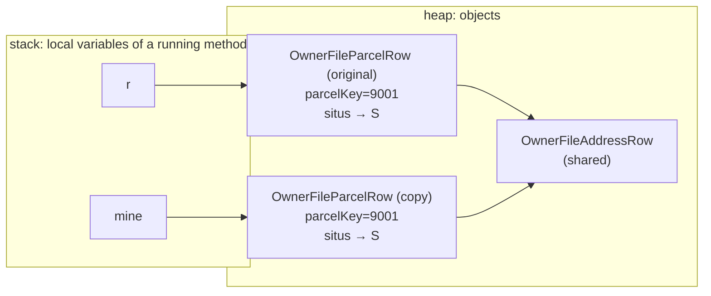
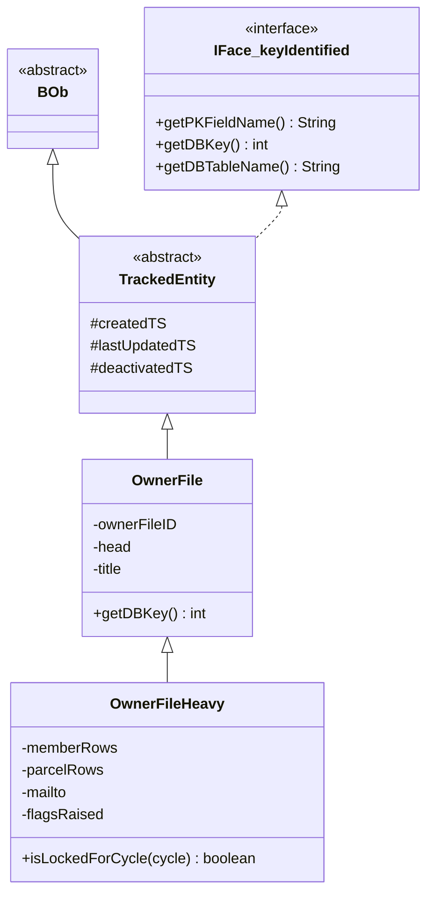

# Owner Files — Java Class Design Primer

This page teaches the **Java mechanics** the owner-file classes are built from, one concept at a time, each
anchored in real code. It is the first of two OOP pages. The second,
[OwnerFileDeriver vs a regular coordinator](/dev/subsystems/workflow-builder/owner-files-deriver-vs-coordinator),
uses these ideas to compare the two *kinds* of class in this codebase and to explain state, threads and
scope. Read this one first.

Snippets marked **(repo)** are quoted from the codebase. Snippets marked **(illustration)** are invented to
make a point and are not in the repo.

> **Java level.** The root `pom.xml` sets `<release>21</release>`, and this workspace runs JDK 21. Older notes
> (including the repo's agent guide) say "Java 8"; that is stale for this facility. The owner-file code uses
> **text blocks** (`"""…"""`), **records**, `String.formatted(...)` and `List.of(...)`, all newer than Java 8.
> Each is explained below where it appears.

## 1. Classes, objects and references

A **class** is a blueprint; an **object** (instance) is one thing built from it with `new`. The class says what
data (fields) an object holds and what it can do (methods).

```java
// (repo) the blueprint:  entities/workflow/OwnerFileParcelRow.java  (abridged)
public class OwnerFileParcelRow {
    private int parcelKey;
    private String parcelIDCnty;
    private OwnerFileAddressRow situs;
    ...
}
```

A **variable of a class type holds a reference** (an arrow to an object on the heap), not the object itself.
Copying the variable copies the *arrow*:



```java
// (repo) assembleFile: every file gets its own copy of a parcel row
OwnerFileParcelRow mine = new OwnerFileParcelRow(r);   // a SECOND object; r still points at the first
mine.setOwnedByHead(true);                              // changes only the copy
```

Three consequences you use constantly:

1. **`a = b` makes two names for one object.** Changing it through either name changes it for both.
2. **`==` compares references** ("is it the *same object*?"); **`.equals(...)` compares contents** (for types
   that define it). For `String` and `Integer` always use `equals` (or unbox; see §10).
3. **A reference can be `null`.** Calling a method on `null` throws `NullPointerException`. The facility's
   convention for "not set" is `0` for ids and `null` for text/objects (the integrator converts `0` ↔ SQL
   `NULL`).

## 2. Fields, methods, constructors, and who may see them

| Member | What it is | Example (repo) |
|---|---|---|
| **Field** | A variable that belongs to an object (or, if `static`, the class) | `private String title;` in `OwnerFile` |
| **Method** | A function that runs on an object (it can use `this`) | `public boolean isLockedForCycle(String rentalCycle)` in `OwnerFileHeavy` |
| **Constructor** | Code that runs once when `new` creates the object; same name as the class, no return type | `public OwnerFileParcelRow(OwnerFileParcelRow r)` (a copy constructor) |

**Access modifiers** control who may use a member:

| Modifier | Visible to | Used here for |
|---|---|---|
| `public` | everyone | the API: `derive(Input)`, `ownerfile_deriveSaved(...)`, getters |
| `protected` | the same package and subclasses | `TrackedEntity.createdTS` etc. |
| *(none)* "package-private" | the same package only | fields of `DeriveContext` (a private nested class, so only the deriver can reach them anyway) |
| `private` | the same class only | every helper method in the deriver; every entity field |

**Encapsulation** = keep the data `private` and expose it through methods, so the class controls how it
changes. The entities do this with **JavaBean getters and setters**:

```java
// (repo) OwnerFileParcelRow
public List<String> getGroupNames() { return groupNames; }
public void setGroupNames(List<String> groupNames) {
    this.groupNames = groupNames == null ? new ArrayList<>() : groupNames;   // a setter can enforce a rule
}
```

The getter/setter naming (`getX`/`setX`, `isX` for booleans) is not decoration: **JSF's Expression Language
finds properties by those names**. `#{seed.lorTitle}` calls `getLorTitle()`. That is why entities that appear
on screens follow the convention strictly.

The deliberate exception is `OwnerFileDeriver.Input` (§6), whose fields are `public` with no getters. That is
not sloppiness: see "parameter object" below.

A class with **no constructor written** gets a free, empty, public **default constructor** from the compiler.
`OwnerFileDeriver` declares none; `javap` shows `public OwnerFileDeriver();` in the compiled class.

## 3. `static` vs instance

An **instance** member belongs to *one object*; a **`static`** member belongs to the *class* (one copy for the
whole program, no object needed).

| | instance | `static` |
|---|---|---|
| Belongs to | one object | the class |
| Created | each `new` | once, when the class is first loaded |
| Can use `this` | yes | **no** |
| Typical use | per-object data and behavior | constants, pure helpers, shared immutable objects |

```java
// (repo) OwnerFileDeriver: static helpers and constants
private static final int MAX_LISTED_IN_DETAIL = 4;           // a constant

private static String lower(String s) {                      // needs no object state → static
    return s == null ? "" : s.toLowerCase();
}

private static final Comparator<OwnerFileAddressRow> FRESHEST_FIRST = (a, b) -> { ... };   // built once, shared
```

- **`static final` constants** (`MAX_LISTED_IN_DETAIL`, the comparators) are built **once at class-load time**
  by the compiler-generated *static initializer* (`static {}` in the `javap` output). They are shared by every
  call and every thread, which is safe because they never change.
- **Static methods are for logic that needs no object.** `lower`, `leadingNumber`. Calling one cannot touch
  instance fields, so it cannot leak state.
- **Utility classes** are a pattern: a class that is *only* static methods. Look at how
  `OwnerFileAddressText` is built:

```java
// (repo) coordinators/OwnerFileAddressText.java
public final class OwnerFileAddressText {
    private OwnerFileAddressText() {            // private constructor: nobody can write "new OwnerFileAddressText()"
    }
    public static String streetLine(OwnerFileAddressRow a) { ... }
    public static String oneLine(OwnerFileAddressRow a) { ... }
    public static String normalize(String text) { ... }
}
```

`final` stops anyone subclassing it; the private constructor stops anyone instantiating it. You call it as
`OwnerFileAddressText.oneLine(row)`. `OwnerFileLabelLines` is built the same way.

> **Rule of thumb.** `static` is for things that are the same for everyone and never change. **Never** use
> `static` for data that varies by user or by request (a `static` mutable field is a global variable shared by
> every user of the server). The next page explains why this matters so much on a web server.

## 4. `final`

`final` means "assigned once, never reassigned". It reads differently by position:

| Where | Meaning | Repo example |
|---|---|---|
| a **field** | the variable can be set only in its declaration or constructor | `final Input in;` in `DeriveContext`; `private final OwnerFileDeriver deriver` in the coordinator |
| a **class** | no subclass is allowed | `public final class LabelRenderer`, `OwnerFileAddressText` |
| a **local/parameter** | the name is bound once | used implicitly by lambdas (§8) |

**`final` is about the variable, not the object.** `final Map<Integer, Integer> foldedInto = new LinkedHashMap<>();`
means the *field can never point at a different map*; you can still `put` into that map all day. `final` makes
a *reference* constant, not the *contents*.

In `DeriveContext` every field is `final` and is initialised at the declaration: one working-memory set per
call, created exactly once, never swapped out.

## 5. Nested classes (the heart of `OwnerFileDeriver`'s structure)

A **nested class** is a class declared inside another class. Java has four kinds:

| Kind | Declared | Has a hidden link to an outer *object*? | Repo example |
|---|---|---|---|
| **Static nested** | `static class X` inside the outer class | **No** | `OwnerFileDeriver.Input`, `OwnerFileDeriver.DeriveContext`, `OwnerFileCoordinator.DeriveSetup` |
| **Inner (non-static)** | `class X` inside the outer class, no `static` | **Yes** (`Outer.this`) | not used in the facility |
| **Local** | inside a method body | yes if the method is an instance method | not used |
| **Anonymous / lambda** | `new Interface() {...}` or `(a, b) -> ...` | captures what it uses | the `Comparator` lambdas |

### Static nested = "a normal class that lives in the outer class's namespace"

```java
// (repo) abridged
public class OwnerFileDeriver {

    /** Everything the bulk reads produced; the deriver touches nothing else. */
    public static class Input { public int muniCode; public List<OwnerFileParcelRow> ownerLinks = new ArrayList<>(); ... }

    /** Per-call working state, in the house "context inner class" shape. */
    private static class DeriveContext {
        final Input in;
        final Map<Integer, List<OwnerFileParcelRow>> parcelRowsByOwner = new LinkedHashMap<>();
        ...
        DeriveContext(Input in) { this.in = in; }
    }
    ...
}
```

Why nest at all rather than make three separate files?

- **Cohesion.** `Input` and `DeriveContext` exist *only* to serve `derive(...)`. Keeping them in the same file
  documents that.
- **Privacy.** `DeriveContext` is `private`: **no other class can even name it**. The coordinator cannot create
  one or hold one. It is an implementation detail with a compiler-enforced wall around it. `Input` is `public`
  because the coordinator must build one; it is referred to from outside as `OwnerFileDeriver.Input`.
- **Access to the outer class's private members.** A nested class and its outer class can use each other's
  private members. (Since Java 11 the JVM supports this directly; the older compiler trick of generating
  accessor methods is gone.)

### Why `static`: no hidden outer reference

If `DeriveContext` were declared **without** `static`, it would be an **inner class**: every instance would
secretly carry a reference to the specific `OwnerFileDeriver` object that created it (the compiler adds a field
called `this$0`). That has costs: a larger object, a hidden dependency, and an object that can only be created
*from* an outer instance. The compiled output proves the real class has none:

```text
$ javap -p -cp target/classes 'com.tcvcog.tcvce.coordinators.OwnerFileDeriver$DeriveContext'
class …OwnerFileDeriver$DeriveContext {
  final …OwnerFileDeriver$Input in;
  final java.util.Map<Integer, List<OwnerFileParcelRow>> parcelRowsByOwner;
  …                                                   (no this$0 field)
  …OwnerFileDeriver$DeriveContext(…OwnerFileDeriver$Input);     (constructor takes only Input)
}
```

(The `$` in the names is how the compiler names nested classes: `Outer$Inner.class`. In the `target/classes`
folder you will find `OwnerFileDeriver.class`, `OwnerFileDeriver$Input.class`, `OwnerFileDeriver$DeriveContext.class`
and a fourth, `OwnerFileDeriver$1.class`. That last one is a **compiler-generated helper** that lets a
`switch` on an enum work: it holds the `$SwitchMap$…OwnerFileMailtoProvenance` array used by
`summarize(...)`. You never write it.)

**Default to `static` for nested classes.** Use a non-static inner class only when the nested object truly
needs the outer object's instance fields. Nothing in this facility does.

## 6. The patterns that name what these classes are

The facility uses a handful of recurring object shapes. Knowing the name tells you what a class is *for*.

| Pattern | What it is | Where | Why |
|---|---|---|---|
| **Parameter object** | One object that carries *all* the inputs to an operation instead of a long argument list | `OwnerFileDeriver.Input` | `derive(Input)` has one parameter, not twenty. Adding an input means adding a field, not changing every caller. Public fields suit it because it has no rules to protect: it is a labelled bag filled by one caller |
| **Context object** | One object holding the *working state* of one run of an algorithm | `DeriveContext`, `OwnerFileCoordinator.DeriveSetup` | Helper methods take `ctx` instead of reading shared fields (see the [next page](/dev/subsystems/workflow-builder/owner-files-deriver-vs-coordinator)); it is created per call and thrown away. The repo calls this the "context inner class" house shape |
| **Result object** | One object that carries *all* the outputs | `OwnerFileDerivation`, `OwnerFileProposeResult`, `OwnerFileLabelRun` | Returns files + flags + summary together; callers pick what they need |
| **Entity** | An object mirroring one database row | `OwnerFile`, `OwnerFileLog`, `OwnerFileSeedLor` | Extends `TrackedEntity`; has `getDBTableName` / `getPKFieldName` / `getDBKey` |
| **DTO / row** | A flat object shaped like a query result, not a table | `OwnerFileParcelRow`, `OwnerFileControlEdgeRow`, `OwnerFileMemberRow`, `OwnerFileAddressRow` | Cheap to build from a `ResultSet`; what the deriver consumes and produces |
| **Heavy / light pair** | A light entity and a subclass that adds derived data | `OwnerFile` / `OwnerFileHeavy` | "Heavy" = the row *plus* everything computed from the graph (§7) |
| **Factory method** | A method that builds a correctly initialised object so callers never call `new` themselves | `ownerfile_getNewOwnerFile(...)` | Repo rule BB-7: beans never `new` entities |
| **Copy constructor** | A constructor taking another object of the same class | `OwnerFileParcelRow(OwnerFileParcelRow)`, `OwnerFileHeavy(OwnerFileHeavy)` | Duplicates an object so two owners do not share state (§12) |
| **Utility class** | `final` class of `static` methods, private constructor | `OwnerFileAddressText`, `OwnerFileLabelLines` | Pure text helpers with no state |
| **Strategy** | Passing *behavior* as an object | `Comparator` constants, lambdas | Sorting rules as named, shareable objects |
| **Service locator** | Asking a registry for the shared service object | `getOwnerFileCoordinator()` | The repo's way to reach singletons; compared on the next page |

Notice the **shape rule** the facility follows: *the more a class is shared, the less state it holds.* The
shared singletons (coordinator, integrator) hold almost none; the throwaway per-call objects (`Input`,
`DeriveContext`, results) hold all of it.

## 7. Inheritance, interfaces and composition

**Inheritance** (`extends`) means "is a kind of". The subclass gets the parent's fields and methods and can add
or override them.



```java
// (repo)
public abstract class TrackedEntity extends BOb implements IFace_keyIdentified { protected LocalDateTime createdTS; ... }
public class OwnerFile extends TrackedEntity { ... @Override public int getDBKey() { return ownerFileID; } }
public class OwnerFileHeavy extends OwnerFile { private List<OwnerFileMemberRow> memberRows = ...; ... }
```

Read the chain as **"an `OwnerFileHeavy` is an `OwnerFile` is a `TrackedEntity` is a `BOb`"**.

- **`abstract class`** (`TrackedEntity`, `BOb`): cannot be instantiated; exists to be extended. It carries
  shared fields (`createdTS`, `lastUpdatedBy`, `deactivatedTS`, …) so every entity has the lifecycle columns.
- **`interface`** (`IFace_keyIdentified`): a *contract*, methods with no body. A class that `implements` it
  promises to supply them (`getPKFieldName()`, `getDBKey()`). That lets generic code say "give me anything with
  a database key" without knowing its class. `OwnerFile` fulfils the contract with `@Override` methods.
- **`@Override`**: asks the compiler to verify you really are replacing a parent/interface method (a typo
  becomes a compile error rather than a silent new method).
- **Constructors are not inherited**, which is why `OwnerFileHeavy` writes its own copy constructor and sets
  every field.
- **Polymorphism**: a subclass instance can be used wherever the parent type is expected. The integrator's
  `retireOwnerFile(OwnerFile file, …)` accepts an `OwnerFileHeavy` because a heavy file *is* an owner file.

### Why "Heavy" is a subclass

`OwnerFile` maps one-to-one to `workflow.ownerfile` (the **declared** state). `OwnerFileHeavy` *adds* everything
derived from the link graph, none of it persisted. Using inheritance lets any method that only needs the
declared part accept either one, while the panel works with the richer object. The Javadoc states the contract:
"Nothing here is persisted."

### Composition: "has a" rather than "is a"

Composition (a field that holds another object) is usually the more flexible tool:

- `OwnerFileHeavy` **has** lists of member rows and parcel rows and a `OwnerFileMailtoResolution`.
- `OwnerFileCoordinator` **has** a deriver: `private final OwnerFileDeriver deriver = new OwnerFileDeriver();`.

The coordinator **uses** the deriver; it does not extend it. That is why the deriver can be swapped,
exercised alone, or reused by the badge lookup without dragging a web-server base class along.

> **Inheritance for reuse has a cost.** The coordinators and integrators extend `BackingBeanUtils` (1,533
> lines, 45 service-provider methods, itself extending `DateTimeUtil`) just to borrow helpers such as
> `getPostgresCon()`. Every subclass is then coupled to that base's fields and behavior. The deriver, entities
> and label engine do **not** extend it: that is part of why they are easy to reason about. The next page
> shows a concrete hazard that comes from state living in that shared base class.

## 8. Interfaces you can pass around: lambdas and `Comparator`

A **functional interface** is an interface with exactly one abstract method. A **lambda** `(a, b) -> expr` is a
compact way to *create an object that implements it*. `Comparator<T>` has one method,
`int compare(T a, T b)` (negative / zero / positive). So a comparator is "sorting behavior as an object".

```java
// (repo) OwnerFileDeriver: a named, reusable sorting rule
private static final Comparator<OwnerFileAddressRow> FRESHEST_FIRST = (a, b) -> {
    LocalDateTime ta = a.getLinkLastUpdatedTS();
    LocalDateTime tb = b.getLinkLastUpdatedTS();
    if (ta == null && tb != null) { return 1; }          // null timestamps sort last
    if (ta != null && tb == null) { return -1; }
    if (ta != null) {
        int c = tb.compareTo(ta);                         // later timestamp first
        if (c != 0) { return c; }
    }
    return Integer.compare(b.getLinkID(), a.getLinkID()); // tie-break: higher link id first
};
```

Used as `list.sort(FRESHEST_FIRST)`. Three more things to recognise:

- **Chaining**: `Comparator.comparing(f -> lower(f.getTitle())).thenComparingInt(f -> f.getHead().getHumanID())`
  builds "by title, then by head id" from small parts.
- **Method references**: `Comparator.comparingInt(OwnerFileMembership::getOwnerFileID)` is shorthand for
  `m -> m.getOwnerFileID()`.
- **Closures**: a lambda can use local variables from the method around it, **only if they are effectively
  final** (never reassigned). `resolveDerivedMailto` sorts candidates with a comparator that reads the local map
  `parcelsByAddress`; it works because that variable is never reassigned after it is built.

**Why static-final comparators are safe to share:** these lambdas capture *nothing* and hold no state, so one
instance can serve every thread forever.

## 9. Generics and collections

`List<OwnerFileParcelRow>` means "a list that holds only `OwnerFileParcelRow`s". The angle brackets are
**generics**: the compiler checks the element type, so you avoid casts and wrong-type bugs.

Decode the nastiest declaration in the deriver one layer at a time:

```java
final Map<Integer, LinkedHashMap<Integer, OwnerFileControlEdgeRow>> controllersOf = new HashMap<>();
```

| Piece | Reads as |
|---|---|
| `Map<K, V>` | a lookup table from key `K` to value `V` |
| outer `Integer` | the key: **the controlled entity's human id** |
| `LinkedHashMap<Integer, OwnerFileControlEdgeRow>` | the value is *another* map: **controller id → the control edge** |
| result | `controllersOf.get(entityId)` = "who controls this entity, and via which edge"; its `.size()` is the controller count |

The **collection types** each promise something different:

| Type | Order | Duplicates | Use here |
|---|---|---|---|
| `ArrayList` / `List` | insertion order, indexed | allowed | row lists |
| `HashMap` / `HashSet` | **no guaranteed order** | keys/elements unique | fast membership tests, lookups |
| `LinkedHashMap` / `LinkedHashSet` | **insertion order kept** | unique | when output order must be stable (`heads`, `foldedInto`, `controllersOf` inner maps) |
| `List.of(...)` | fixed | allowed | **immutable**: `add` throws `UnsupportedOperationException`; used for one-element lists such as `List.of(log)` |

Idioms worth recognising on sight:

```java
// (repo) "get the list for this key, creating it the first time", then add to it
ctx.parcelRowsByOwner.computeIfAbsent(r.getOwnerHumanID(), k -> new ArrayList<>()).add(r);

// "only record the first controller seen for this pair" (parallel edges collapse to one)
ctx.controllersOf.computeIfAbsent(controlled, k -> new LinkedHashMap<>()).putIfAbsent(controller, e);

// "the list, or an empty one if absent" (never null, so the loop below cannot NPE)
for (OwnerFileParcelRow r : ctx.parcelRowsByOwner.getOrDefault(headID, Collections.emptyList())) { … }
```

`computeIfAbsent(key, k -> new ArrayList<>())` replaces the older, error-prone
"`if (map.get(key) == null) map.put(key, new ArrayList<>()); map.get(key).add(r);`".

**Program to the interface, create the implementation.** Fields are declared `Map`/`List`/`Set` and built as
`HashMap`/`ArrayList`/`HashSet`. Callers depend on the capability, not the class, so the implementation can
change. The empty `<>` ("diamond") tells the compiler to infer the type arguments.

## 10. `int` vs `Integer`: autoboxing and identity traps

Generics cannot hold primitives, so every `Map<Integer, …>` stores `Integer` **objects**. Java converts
automatically (**boxing** `int → Integer`, **unboxing** `Integer → int`). It is convenient and has two sharp
edges.

**Edge 1: unboxing `null` throws.** `int x = map.get(key);` throws `NullPointerException` if `key` is absent.
The deriver avoids it by always testing for null first (`if (controllers != null && controllers.size() == 1)`)
or using `getOrDefault`.

**Edge 2: `==` on two `Integer` objects compares references.** Java caches small `Integer`s (−128 to 127), so
`==` "works" in tests and silently fails for larger ids. Compare with `.equals` or force unboxing.

```java
// (repo) assembleFile:  fold.getValue() is an Integer, headID is an int
if (fold.getValue() != headID) { continue; }
// One side is a primitive int, so Java UNBOXES the Integer and compares NUMBERS. Safe.

// (illustration) the trap:  Integer a = 1000, b = 1000;   a == b   →  false (different objects)
```

`ctx.heads.contains(only)` is also safe: `Set.contains` uses `equals`. The rule: **if both sides are `Integer`
objects, never `==`.**

## 11. Enums are classes

A Java `enum` is a class with a fixed, named set of instances (each constant is one singleton object). They can
carry **fields, constructors and methods**.

```java
// (repo) OwnerFileSeedKind (abridged)
public enum OwnerFileSeedKind {
    OWNS_PARCEL("Owns parcel"),
    OWNER_OCCUPANT("Owner-occupant of parcel"),
    CONTROLS_HUMAN("Controls human");

    private final String label;
    OwnerFileSeedKind(String label) { this.label = label; }
    public String getLabel() { return label; }
    public boolean isParcelOwnershipKind() { return this == OWNS_PARCEL || this == OWNER_OCCUPANT; }
}
```

- **Compare enum values with `==`** (there is exactly one instance of each constant).
- **`name()` / `valueOf(String)`** convert to and from text. The database stores the *name*:
  `OwnerFileSeedKind.valueOf(text)` turns `'CONTROLS_HUMAN'` back into the constant (and throws
  `IllegalArgumentException` for text it doesn't know, which `parseSeedKind` catches and turns into `null`).
- **`switch` on an enum** is how the code dispatches (`classifySeeds`, the provenance counters in `summarize`).
- **Behavior lives with the constant.** `OwnerFileLogOperation` carries `defaultRequiresReview`;
  `OwnerFileFlag` carries severity, label and description; `OwnerFileMailtoProvenance.isClerkDecision()`
  answers a question about itself. This beats scattering `if (x == A || x == B)` through callers.

Two rules this creates for you:

1. **Order can be meaning.** `OwnerFileSeverity` is declared `INFO, WARNING, ERROR, CRITICAL`, and its Javadoc
   says "Declared in ascending order so `compareTo` sorts least to most severe." The deriver sorts flags with
   `.comparing(severity).reversed()`. **Reordering those constants silently re-sorts every flag list.**
2. **Never rename a stored constant.** Enum names are persisted as text (`ownerfilelog.operation`,
   `seedkind`). Rename `LOCKED_FOR_CYCLE_MAILING` and every historic row becomes unrecognisable. Add new
   constants instead.

## 12. Records: immutable data carriers

A **record** is a compact class for plain data. You list the components; the compiler writes the constructor,
accessors, `equals`, `hashCode` and `toString`, and every field is `final`.

```java
// (repo) entities/workflow/OwnerFileLabelPlacement.java
public record OwnerFileLabelPlacement(int fileID, int headHumanID, String title, int sheet, int slot,
        int addressID, int addressLinkID, boolean humanLink, List<String> lines)
        implements Serializable { }
```

Usage looks like `p.sheet()` and `p.slot()` (accessors are named after the component, **not** `getSheet()`).
Contrast with a JavaBean entity: no setters, nothing can change after construction. That fits "where did this
label land?": a fact recorded once. Records appear only on the Java side of the facility (log-writing
code); the JSF screens bind to ordinary getter/setter classes. (Jakarta EE 9.1's Expression Language resolves
properties through getters, which a record does not have. **UNVERIFIED** for your exact EL version; it is the
reason to keep records out of XHTML bindings.)

## 13. Copying objects: shallow vs deep

Because variables hold references (§1), "copy" has two meanings:

- **Shallow copy**: the new object gets *the same references* as the old one for its reference-type fields.
  Primitives are duplicated; referenced objects are shared.
- **Deep copy**: referenced objects are duplicated too.

`OwnerFileParcelRow`'s copy constructor is **shallow on purpose**:

```java
// (repo)
public OwnerFileParcelRow(OwnerFileParcelRow r) {
    this.ownerHumanID = r.ownerHumanID;        // int: duplicated
    this.ownedByHead = r.ownedByHead;          // boolean: duplicated  (the per-file flags we want to differ)
    this.situs = r.situs;                      // reference: SHARED (the address object is never changed afterwards)
    this.groupNames = r.groupNames;            // reference: SHARED ("read-only once set, so copies may share it")
    …
}
```

Why copy at all? Two files can list the same parcel (a saved head also folded into another file). The per-file
flags (`ownedByHead`, `mailtoAtThisParcel`) must not collide, so each file gets **its own row object**. The
big shared objects (`situs`, `groupNames`) are safe to alias because nothing writes to them after the copy
(the field comment says so). If anything ever mutated `situs` through one copy, **both** files would see it:
that is the "list alias bug" the repo's guide warns about
(`entity.setItems(new ArrayList<>(entity.getItems()))` to break the alias).

**Rule:** before you mutate an object you did not create, ask "who else holds a reference to this?"

## 14. Exceptions: checked vs unchecked

Java has two kinds of failures:

- **Checked** exceptions extend `Exception` (but not `RuntimeException`). The compiler **forces** every caller
  to catch or declare them (`throws`).
- **Unchecked** exceptions extend `RuntimeException`. They can propagate without being declared (`NullPointerException`,
  `IllegalArgumentException`).

The repo's own set, all **checked** (they extend `BaseException extends Exception`): `IntegrationException`
(database), `BObStatusException` (business rule / bad state), `AuthorizationException` (permission). That is why
coordinator methods declare `throws AuthorizationException, BObStatusException, IntegrationException`:

```java
public int ownerfile_createFile(OwnerFile draft, Municipality muni, OwnerFileGroupChoice referenceGroup, UserAuthorized ua)
        throws AuthorizationException, BObStatusException, IntegrationException { ... }
```

Layering of failure types is part of the design: the **integrator** wraps `SQLException` into
`IntegrationException`; the **coordinator** throws `BObStatusException` with a **clerk-readable message** and the
bean shows it.

**Cleanup with `finally`.** Every integrator read ends with
`finally { releasePostgresConnection(con, stmt, rs); }`. `finally` runs whether the `try` succeeded or threw,
so a connection can never leak. (Java also has *try-with-resources* for `AutoCloseable` objects; the repo's
house style predates it and uses explicit `finally`. Match the house style.)

## 15. Newer syntax you will meet

| Syntax | Meaning | Where |
|---|---|---|
| `"""…"""` **text block** | A multi-line string literal that keeps line breaks and ignores incidental indentation | Every multi-line SQL in `OwnerFileIntegrator` (`getSeedLorList`, `SHELL_SELECT`, …) |
| `"""…""".formatted(a, b)` | `String.format` as a method on the string; `%1$s` = first argument | `addressColumns(alias)` builds SQL with the alias substituted |
| `List.of(x)` | Immutable list | `insertOwnerFileLogBatch(List.of(log))` |
| `record` | §12 | `OwnerFileLabelPlacement` |
| `x -> …`, `Type::method` | §8 | comparators, `computeIfAbsent` |
| `instanceof` / enhanced `switch` | not used in the deriver; plain `switch` statements with `break` are | `classifySeeds` |

## 16. Glossary

| Term | One-line meaning |
|---|---|
| **Object / instance** | One thing built from a class with `new` |
| **Reference** | The "arrow" a variable holds to an object |
| **Heap / stack** | Where objects live / where a running method's local variables live |
| **Encapsulation** | Hide fields; expose behavior through methods |
| **JavaBean** | A class with a no-arg constructor and `getX`/`setX` pairs; what JSF binds to |
| **`static`** | Belongs to the class, not to an object |
| **`final`** | Assigned once (a field/variable), or cannot be extended (a class) |
| **Nested class** | A class declared inside another; `static` nested = no hidden outer reference |
| **Inner class** | A non-static nested class that carries `Outer.this` |
| **Abstract class** | A class you cannot instantiate; exists to be extended |
| **Interface** | A contract of methods a class promises to supply |
| **Polymorphism** | A subclass object used where the parent type is expected |
| **Composition** | An object that *has* other objects as fields |
| **Lambda** | A compact object implementing a one-method interface |
| **Generics** | Type parameters (`List<T>`) the compiler checks |
| **Boxing** | Automatic `int` ↔ `Integer` conversion |
| **Record** | A compact immutable data class |
| **Shallow copy** | A copy that shares the original's referenced objects |
| **Checked exception** | One the compiler forces callers to handle |
| **Parameter object** | An object bundling all inputs to an operation (`Input`) |
| **Context object** | An object bundling the working state of one run (`DeriveContext`) |
| **Utility class** | `final` class of static methods with a private constructor |

Continue with
[OwnerFileDeriver vs a regular coordinator](/dev/subsystems/workflow-builder/owner-files-deriver-vs-coordinator):
the same concepts applied to *state, threads and scope*, and a side-by-side with `PropertyCoordinator`.
