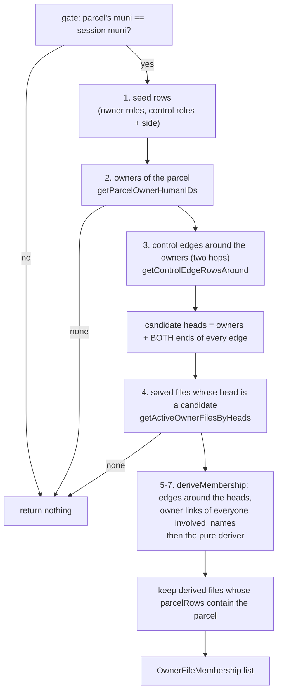

# Owner Files — Reverse Lookup (Badges) and Scaling Review

Prerequisites: [derivation theory](/dev/subsystems/workflow-builder/owner-files-derivation-theory) and the
[read path](/dev/subsystems/workflow-builder/owner-files-read-path-code). This page documents the
**Phase 17 Layer 0** feature: a badge on the property and person profiles that says *"this parcel is in
owner file 124 and here is why."* Section 8 onward is a **scaling review**: where the lookup is light, where
it is not, and what to do about it. The review is written from reading the code and the schema, **not from
measurement** (no one on this project had database access); every performance statement is labelled
**UNVERIFIED** until ECD runs `EXPLAIN`.

## 1. The question the badge answers

Everything else in the facility goes **file → parcels** (start from a head, walk out). The badge goes the
other way, **parcel (or person) → files**:

| Lookup | Question | Answer |
|---|---|---|
| **By property** (`ownerfile_getMembershipsForProperty`) | "Which active saved owner files list this parcel, and why?" | 0, 1, or 2+ files (2+ = an overlap, shown in warning style, never hidden) |
| **By person** (`ownerfile_getMembershipsForPerson`) | "Which saved owner file does this person head, or sit inside?" | 0 or 1 file |

Each result row is an `OwnerFileMembership`: file number, display title, head, a **reason**
(`OwnerFileMembershipReason`), and the **link that causes it** (`viaLinkID`, so a clerk knows which link
to fix).

| Reason | Meaning |
|---|---|
| `PARCEL_OWNER_IS_HEAD` | The owner of record on the parcel **is** the head |
| `PARCEL_OWNER_IS_FOLDED_ENTITY` | The owner of record is an entity the head controls (folded in) |
| `PERSON_IS_HEAD` | The person heads the file |
| `PERSON_IS_FOLDED_ENTITY` | The head is the person's sole controller and the person owns parcels in the file |

<!-- SCREENSHOT NEEDED: The property profile "Owner file" row showing the badge "In rental owner file" with the chip "File 124: <title> (held by an entity the file's head controls)". -->

## 2. The design constraint: no stored membership

ECD's ruling (Q-V17-1): **the existing links stay the single source of truth.** No enrollment table, no
membership rows, no DDL. So the lookup must *compute* its answer from the live graph every time, and the
design question becomes: how do you answer "which files list parcel P?" **without** deriving every file in
the municipality?

The answer is a **funnel**: use cheap, indexed reads to narrow to a *handful* of candidate files, then run
the real derivation on just those.

## 3. The funnel for a parcel



The code (abridged from `OwnerFileCoordinator.ownerfile_getMembershipsForProperty`):

```java
if (prop == null || prop.getParcelKey() == 0 || !ownerfile_isMembershipVisible(sessionMuni, prop.getMuni(), ua)) {
    return found;                                                         // fence + gate
}
DeriveSetup setup = membershipSetup(sessionMuni);                         // read 1: seed rows
if (setup == null) { return found; }                                      // no owner role seeded → nobody can be an owner
List<Integer> owners = ofi.getParcelOwnerHumanIDs(sessionMuni.getMuniCode(), prop.getParcelKey(), setup.ownerLorIDs);   // read 2
if (owners.isEmpty()) { return found; }
Set<Integer> candidateHeads = new LinkedHashSet<>(owners);
addEdgeEnds(candidateHeads, ofi.getControlEdgeRowsAround(owners, setup.controlLorIDs));   // read 3 → candidates = owners ∪ both edge ends
List<OwnerFileHeavy> shells = ofi.getActiveOwnerFilesByHeads(sessionMuni.getMuniCode(), candidateHeads);   // read 4
if (shells.isEmpty()) { return found; }                                   // ← the cheap negative path (most parcels)
OwnerFileDerivation derived = deriveMembership(sessionMuni, setup, shells);   // reads 5–7 + pure derive
for (OwnerFileHeavy f : derived.getFiles()) {
    OwnerFileParcelRow listed = null;
    for (OwnerFileParcelRow r : f.getParcelRows()) {
        if (r.getParcelKey() == prop.getParcelKey() && (listed == null || (!listed.isOwnedByHead() && r.isOwnedByHead()))) {
            listed = r;                                                   // prefer the head's own link as the reason
        }
    }
    if (listed != null && f.getOwnerFileID() != 0) {
        OwnerFileMembership m = newMembership(f);
        m.setReason(listed.isOwnedByHead() ? PARCEL_OWNER_IS_HEAD : PARCEL_OWNER_IS_FOLDED_ENTITY);
        m.setViaHumanID(listed.getOwnerHumanID());
        m.setViaName(listed.getOwnerName());
        m.setViaLinkID(listed.getHumanParcelLinkID());
        found.add(m);
    }
}
```

### Why "candidate heads = owners plus **both** ends of every edge"

The lookup does not try to interpret direction. Which end of a control edge is the controller depends on the
seed row's `controllerside`, and **only the deriver applies that rule** (theory §2). Taking both ends gives a
**superset** of the real candidates. The extras cost almost nothing (a few extra shell lookups) and can never
cause a miss. The deriver, not the lookup, decides who controls whom. That is the design principle of the
whole feature: **the lookup contains no folding rules of its own.**

### Why `deriveMembership` is a separate private method

```java
private OwnerFileDerivation deriveMembership(Municipality muni, DeriveSetup setup, List<OwnerFileHeavy> shells) … {
    OwnerFileIntegrator ofi = getOwnerFileIntegrator();
    OwnerFileDeriver.Input in = setup.input;
    in.headsFromSeedGroup = false;                 // heads = the saved files' heads only
    in.existingFiles = shells;
    Set<Integer> headIDs = …heads of the shells…;
    in.controlEdges = ofi.getControlEdgeRowsAround(headIDs, setup.controlLorIDs);
    Set<Integer> involved = new LinkedHashSet<>(headIDs);
    addEdgeEnds(involved, in.controlEdges);
    in.ownerLinks = ofi.getOwnerLinkRowsForHumans(muni.getMuniCode(), 0, involved, setup.ownerLorIDs, new ArrayList<>());
    in.humans = ofi.getHumanRefs(involved);
    return deriver.derive(in);
}
```

It deliberately does **not** call `readSupportRows`. The full saved-files derivation reads addresses, declared
links, lock rows and group names (~7 extra reads); the badge needs **none of that**: only *which parcels
and which members*. By being a separate method, "the expensive reads cannot be switched back on by a
forgotten flag." Its Javadoc is explicit about the consequence: **the derived files returned here have
correct parcels and members, but an incomplete mail-to and flags** (for example a spurious "declared
address retired" flag, because the declared links were never read). Therefore the lookup builds a slim
`OwnerFileMembership` and **never returns the derived file**. Callers must read only the membership off it.

## 4. The funnel for a person

`ownerfile_getMembershipsForPerson`: seed rows, then control edges around the person, then candidate shells =
**the person's own shell plus the shells of both ends of every edge**, then `deriveMembership`, then:

```java
if (f.getHead().getHumanID() == person.getHumanID()) {
    if (f.getParcelCount() > 0) { … PERSON_IS_HEAD … }          // "owner of rentals" only if the file lists something now
    continue;
}
for (OwnerFileMemberRow member : f.getMemberRows()) {
    if (member.getMemberHumanID() == person.getHumanID() && member.getParcelCount() > 0) {
        … PERSON_IS_FOLDED_ENTITY (via the controller and control link) …
    }
}
```

**The person's own shell must always be in the candidate set.** If it were left out, then for a person who
heads file X *and* is controlled by head Y, the deriver would see Y's file, find X not among the heads, and
**fold X under Y** (theory §8, consequence 2). The answer would be wrong. The review that caught this is
recorded in the Phase 17 doc §17.4.1 B. A person's result is 0 or 1 files: a saved head is never also folded
(protection in block 4), and folding needs exactly one controller.

A file that lists **no parcels now** is not reported ("owner of rentals" would not be true); that is why the
`getParcelCount() > 0` tests exist and why the derived parcel count is needed on the person path.

## 5. Visibility and who sees it

```java
public boolean ownerfile_isMembershipVisible(Municipality sessionMuni, Municipality objectMuni, UserAuthorized ua) {
    return ua != null && sessionMuni != null && objectMuni != null
            && sessionMuni.getMuniCode() == objectMuni.getMuniCode();
}
```

Any signed-in user working in the muni sees the badge (ECD Q-V17-13: **no rank fence**); the only fence is
the muni (so a cross-muni view of another muni's parcel never shows that muni's files). The chip is a *link*
to the Rental registry manager only for MuniStaff and above (`ownerfile_isManageAllowed`); lower roles see
the same text, unlinked. The person lookup is muni-fenced by construction (it uses the session muni).

## 6. The UI side and caching

Two backing beans host the lookup, each with a **managed getter** (BB Rule 4: JSF calls getters 3–6 times
per render, so the answer is cached):

```java
public List<OwnerFileMembership> getManagedOwnerFileMemberships(Property prop) {       // PropertyProfileBB
    Municipality sessMuni = getSessionBean().getSessMuni();
    if (prop == null || prop.getParcelKey() == 0 || sessMuni == null) { return new ArrayList<>(); }
    long revision = getPersonCoordinator().getHumanLinkWriteRevision();
    if (ownerFileBadgeParcelKey == prop.getParcelKey()
            && ownerFileBadgeMuniCode == sessMuni.getMuniCode()
            && ownerFileBadgeRevision == revision) {
        return ownerFileBadgeList;                          // cache hit: same parcel, same muni, no link writes since
    }
    … remember key and revision; call ownerfile_getMembershipsForProperty; on IntegrationException print and show no badge …
}
```

- **Cache key** = (parcel or person id, muni, **link-write revision**).
- **The revision** is an `AtomicLong` on the application-scoped `PersonCoordinator` that its link-write methods
  bump (`insertHumanLink(s)`, `updateHumanLink`, `deactivateHumanLink(s)`). Any link write by **any user or the
  county robot, in this JVM,** makes every cached badge recompute on its next render.
- **Failure is quiet**: a failed lookup prints to stderr and shows **no badge**; it is *advisory* and must never
  break the profile.
- **Both beans are view-scoped** (`faces-config.xml`), so the cache lives only as long as the page view. The
  property bean's getter takes the property as an **argument** because the shared component
  `propInfoCC.xhtml` is hosted by two pages with two different property beans.
- **Staleness limits.** Changes made outside `PersonCoordinator` (direct SQL, another server node) show only
  after a reload. Changes to `workflow.ownerfile` itself (creating, retiring, re-heading a file) do **not**
  bump the revision; they are made on a different page, so the view-scoped cache is discarded on navigation.

The shared component is `resources/components/ownerFileBadgeCC.xhtml`: headline "**In rental owner file**"
(parcel) or "**Owner of 1+ rentals**" (person); 2+ files on a parcel → warning headline "**In N rental owner
files: fix the owner links**"; then one line per file with the reason in words. **No count is shown**
(Q-V17-19).

## 7. What the badge cannot tell you

- **A co-owner who is not the head is not a member.** The file lists the parcel through the head's own link
  and does not name the co-owner, so the co-owner's profile shows no badge. Correct under R-18; it may surprise
  a clerk.
- **It reports what the graph says now.** It cannot say "what did the clerk ratify" and cannot express an
  exclusion. That would need stored enrollment (Layer 1, deferred).
- **It does not explain a *non*-membership.** A parcel owned by an LLC with two controllers shows no badge; the
  `MULTIPLE_CONTROLLERS` warning is on the file list, not on the profile. A "missing-link finder" is backlog.

---

## 8. Scaling review: is it a "light graph walk"?

> **Status of this section.** Reading-based review, 2026-10-19. **No query has been executed.** Claims about
> PostgreSQL plans are **UNVERIFIED** until `EXPLAIN (ANALYZE, BUFFERS)` is run on production-sized data by
> ECD. The design document's own cost note says the same (R17-2).

### 8.1 The short verdict

**Light in shape, not yet light in cost.** The walk is bounded (one level, two hops of edges), set-based
(`= ANY(?)`), index-backed in the places that were checked, free of whole-muni reads, and stores nothing. The
**negative path** (most parcels) is about four tiny reads and exits early. But the **positive path is
O(size of the file)**, not O(1): to answer "is *this one parcel* in file F?" it loads **every parcel of the
head and of every entity the head controls**, then builds and discards a fully derived file.

### 8.2 The cost model, read by read

| # | Read | Where | Scales with | Index (from the schema dump) |
|---|---|---|---|---|
| 1 | Seed rows (`getSeedLorList`) | `membershipSetup` | a handful of rows | none needed |
| 2 | Owners of the parcel | `getParcelOwnerHumanIDs` | owners of one parcel (1–3) | `idx_humanparcel_parcel_active` |
| 3 | Control edges around owners, **2 hops** | `getControlEdgeRowsAround` | edges around those owners | hop 1 uses the endpoint indexes; **hop 2: see 8.3** |
| 4 | Saved files by head | `getActiveOwnerFilesByHeads` | candidate count | `ownerfile_onefileperhead_uidx`; log lateral uses `ownerfilelog_file_ts_idx` |
| ─ | *negative path ends here (≈ 4 reads)* | | | |
| 5 | Control edges around the **heads**, 2 hops | `deriveMembership` | edges around the heads: **grows with a hub's number of controlled entities** | as read 3 |
| 6 | Owner links of **every involved human** | `getOwnerLinkRowsForHumans` | **all parcels** of the head and every entity it controls | `idx_humanparcel_human_active` + a per-row situs lateral |
| 7 | Human names | `getHumanRefs` | involved humans | PK |

Total on a hit: **7 reads**, plus an in-memory derive over whatever read 6 returned.

### 8.3 Findings, in priority order

**F-1: the positive path loads whole files to answer a one-parcel question (the main issue).**
Read 6 returns an `OwnerFileParcelRow` for *every* active owner link of *every* involved human. The deriver
then copies those rows per file, sorts them, resolves mail-to, raises flags, and runs three cross-file passes
(`flagFilesSharingAMailtoAddress`, `flagParcelsInMultipleFiles`, `flagHumansInMultipleFiles`). All of it is
discarded except one `OwnerFileMembership`. For a typical owner (1–20 parcels) this is a few milliseconds. For
a **hub** (a landlord with 50 LLCs and several hundred parcels) it is hundreds of rows per badge render. It
scales with the **largest file touched**, not with the question.

**F-2: hop 2 of the control-edge query probably cannot use the endpoint indexes (UNVERIFIED).**

```sql
SELECT DISTINCT hh.linkid, …
  FROM public.humanhuman hh
 WHERE hh.deactivatedts IS NULL AND hh.archivedts IS NULL
   AND hh.linkedobjectrole_lorid = ANY(?)
   AND (hh.human_humanid IN (SELECT hid FROM ends) OR hh.humantarget_humanid IN (SELECT hid FROM ends))
```

PostgreSQL generally cannot turn **`x IN (SELECT …) OR y IN (SELECT …)`** into semi-joins; it evaluates each
as a *hashed subplan* filter over a scan of the outer table. The two partial indexes
(`idx_humanhuman_human_active`, `idx_humanhuman_target_active`) are each on **one** endpoint, and **no index
covers the role column**, so the likely plan is a **sequential scan of `public.humanhuman`**. That table is
**global across all municipalities**, so this statement's cost grows with the size of the *whole database*,
not with the neighbourhood. It runs **twice on a hit** (reads 3 and 5) and **at least twice for a person**.
Hop 1 (`e1`) uses `= ANY(array)` against both endpoints and *can* use a bitmap-OR over the two indexes.
The design document's probe **P-17-9** only times the owners read and a *single-hop* edge read, so the
heavier stage was never covered.

**F-3: hop 2 is more than a membership answer needs.** The second hop reveals *controllers of controllers*,
which is needed for the **flags** (`DEEP_CHAIN_IGNORED`, shared control) that the lookup discards. For
membership, an owner's controllers are all adjacent to that owner (one hop). The loader re-reads edges
starting from the **heads** (not the owners), which is what *forces* the second hop to see an owner's other
controllers; **read 3 had already fetched exactly those edges, starting from the owners.**

**F-4: the situs lateral still runs.** `deriveMembership` passes an empty situs list, but the lateral join
and the `EXISTS(parcelparcelgroup…)` column (group id `0`) are still in the SQL. Whether PostgreSQL folds the
lateral away depends on the plan it picks for the parameterised statement (UNVERIFIED). Cheap either way
(an index probe per row), but not free for hundreds of rows.

**F-5: the seed rows are re-read on every cache miss.** The design said "cacheable per muni"; the build
deferred it (a stale-config risk on an application-scoped bean). One small read; a TTL cache would remove it.

**F-6: seven sequential connection checkouts, no shared snapshot.** Each integrator call gets its own pooled
connection, one after another. Connection pressure is low (they are not held concurrently) but the answer is
not from a single consistent snapshot: a link write between read 2 and read 6 can yield a momentarily
inconsistent result. Acceptable for an advisory badge.

**F-7: cache invalidation is coarse.** The revision is global to the JVM. During a county-robot import (which
writes owner links through `DataExchangeCoordinator` → `PersonCoordinator.insertHumanLink`), the counter
climbs continuously, so any open profile **recomputes on every render**. Bounded (≤ 7 reads per render) but
wasteful; and a second server node is never notified.

### 8.4 RAM and thread-safety

- **Heap use is transient and proportional to file size**: each derived parcel row is a small object
  (strings, a few ints), copied roughly twice by `assembleFile`. A 500-parcel file is on the order of a
  megabyte of garbage per cache miss (**estimate, not measured**). Nothing is retained: the beans keep only
  the slim `OwnerFileMembership` list (a few objects per view).
- **No shared mutable state in the owner-file classes.** The deriver is stateless; all working state is in the
  call's `DeriveSetup` / `DeriveContext`. The `AtomicLong` revision is the only shared counter, and the
  owner-file code takes identity as arguments. So concurrency inside the facility is not a risk; the pressure
  is **round trips and row volume**, not memory. *(One shared-state hazard does exist underneath, in the base
  class `BackingBeanUtils`'s `getPostgresCon()`, which every integrator uses; see
  [deriver vs coordinator §6.3](/dev/subsystems/workflow-builder/owner-files-deriver-vs-coordinator).)*
- **Data volume reference points** (ECD probes P-5/P-10, Sharpsburg): ~1,500 owned parcels, ~1,155 owners,
  largest owner 21 parcels (WVTE LLC), second 14. At *that* scale every number above is small. The review
  matters for the **larger municipalities** and for **hubs**, and for the **global `humanhuman` scan**
  (F-2), which does *not* depend on any one municipality's size.

### 8.5 Proposed fixes (none implemented)

Ordered cheapest first. Each is a proposal to be **verified**, not a tested change.

1. **Measure first (ECD).** Run `EXPLAIN (ANALYZE, BUFFERS)` on the *full* two-stage statement
   (not only the first stage) for a hub human, and on `readOwnerLinkRows`' `humanIDs` variant:

   ```sql
   EXPLAIN (ANALYZE, BUFFERS)
   WITH e1 AS (
       SELECT hh.human_humanid, hh.humantarget_humanid
         FROM public.humanhuman hh
        WHERE hh.deactivatedts IS NULL AND hh.archivedts IS NULL
          AND hh.linkedobjectrole_lorid = ANY (ARRAY[2205])
          AND (hh.human_humanid = ANY (ARRAY[:hubHumanId]) OR hh.humantarget_humanid = ANY (ARRAY[:hubHumanId]))
   ), ends AS (
       SELECT human_humanid AS hid FROM e1 UNION SELECT humantarget_humanid FROM e1
   )
   SELECT DISTINCT hh.linkid, hh.linkedobjectrole_lorid, hh.human_humanid, hh.humantarget_humanid
     FROM public.humanhuman hh
    WHERE hh.deactivatedts IS NULL AND hh.archivedts IS NULL
      AND hh.linkedobjectrole_lorid = ANY (ARRAY[2205])
      AND (hh.human_humanid IN (SELECT hid FROM ends) OR hh.humantarget_humanid IN (SELECT hid FROM ends))
    ORDER BY hh.linkid;
   ```

   Look for `Seq Scan on humanhuman` and its row estimate and timing. (Use whichever HumanHuman LOR id your
   database seeds; **2205** is the production id in ECD's notes.)

2. **Rewrite stage 2 as two index-friendly branches** if the plan confirms a scan: replace the ORed `IN`
   with `human_humanid = ANY(ARRAY(SELECT hid FROM ends))` **UNION** `humantarget_humanid = ANY(ARRAY(SELECT hid FROM ends))`,
   or collect `ends` into an array first. Equivalent results, endpoint indexes usable. *The row set must
   stay identical; compare the two forms on real data before switching.*

3. **Narrow the property path's derivation input to the question** (the structural fix). The membership of
   parcel *P* in file *F* depends only on: *P*'s owners, the control edges **around those owners**, and which
   humans head saved files. Read 3's edges already contain what the deriver needs to apply the sole-controller
   rule to each owner. So the property path could: skip read 5; feed `in.controlEdges` = read 3's edges; feed
   `in.ownerLinks` = **only the owner links of *P*** (a new parcel-scoped read, not `getOwnerLinkRowsForHumans(involved)`);
   and skip the all-parcels load. The same `deriver.derive` is still the **single source of folding rules**;
   only its *input* shrinks to the neighbourhood of *P*. **Caveats:** `parcelCount` on the result would then
   count only *P* (the property badge does not show it; the person path needs a real count), and this change
   **must be proven equivalent** by comparing narrowed vs full derivation over a set of real parcels (including
   overlaps, 2-controller LLCs and chains) before it replaces the current path.

4. **A no-situs, no-group variant of the owner-link query** so the lateral join and the `EXISTS` do not exist
   in the SQL at all for lookups.

5. **Cache the seed rows per muni** with a short TTL, since they change only by hand-edited SQL.

6. **For the person path**, replace "load every parcel to test `parcelCount > 0`" with an `EXISTS`-style read
   (or one parcel per human via `DISTINCT ON (human_humanid)`).

7. **Only if all of the above fall short:** the deferred **Layer 1** (a stored `workflow.ownerfileenrollment`
   table) would make the badge a single indexed read, at the price of the cache-invalidation problem the
   whole design avoids (theory §1). Phase 17 holds this back "until Layer 0 shows how far the links alone get
   us".

### 8.6 Gate for ECD

Before concluding anything: open a hub landlord's parcel and a one-parcel homeowner's parcel on the property
profile, note the server log for slowness, run the `EXPLAIN` in 8.5 step 1, and paste the "Execution Time"
and the scan node for `humanhuman`. That one result decides whether fixes 2 and 3 are worth building.
