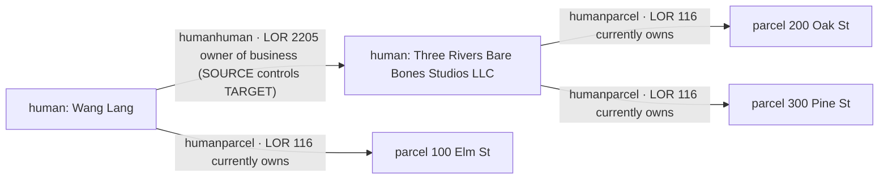
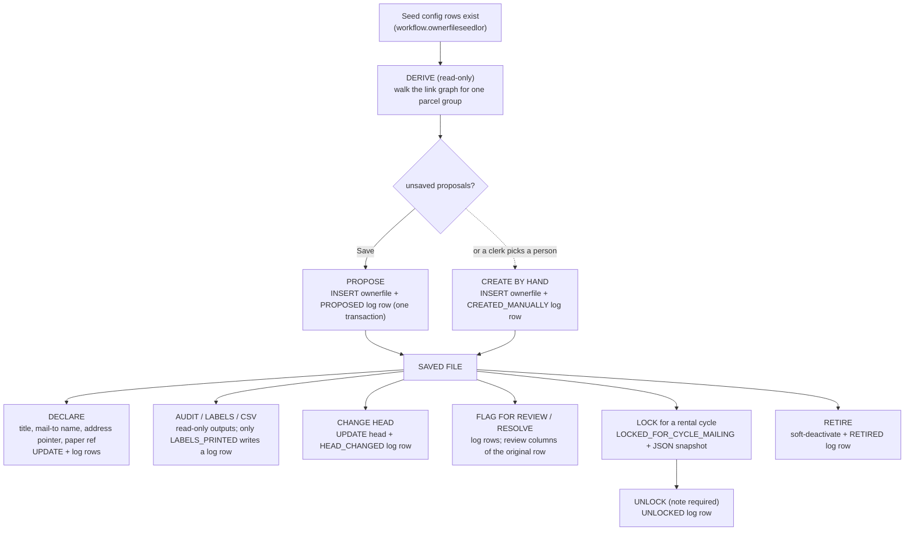

# Owner Files — Orientation and Reading Guide

> **Status of this page set (2026-10-19).** Written from the code and specs as they stood on 2026-10-19.
> The facility is **BUILT** and `mvn clean package -DskipTests` was green at the last build log
> (2026-10-16), but per the implementation spec most of it has **not yet been walked against a database
> and a browser by ECD**. Everything below describes what the code *does*, not what has been *verified in
> production*. Where a statement is an inference rather than a fact read from code, it is marked
> **UNVERIFIED**. The pages are `published: false` until the gates pass (Dev↔Docs policy).

## Who this is for, and how to read the set

You own a codebase facility you did not type yourself. These nine pages are meant to take you from
"I can't follow the graph walk" to "I can read `OwnerFileDeriver` line by line and change it without
breaking the rules." They go from concepts to code. Read them in order the first time.

| # | Page | What you get | Read it when |
|---|---|---|---|
| 1 | **This page** | The one idea, the vocabulary, the code map, the lifecycle, the safety rules | First |
| 2 | [Data model](/dev/subsystems/workflow-builder/owner-files-data-model) | Every Postgres table, column, constraint and index the facility touches, plus the graph vocabulary | Before opening any SQL |
| 3 | [Java class design primer](/dev/subsystems/workflow-builder/owner-files-java-class-design-primer) | The Java mechanics behind the classes: nested classes, `static`, `final`, inheritance, lambdas, generics, enums, records, copying | Before opening `OwnerFileDeriver.java` if nested classes, lambdas or `Map<Integer, LinkedHashMap<…>>` look unfamiliar |
| 4 | [OwnerFileDeriver vs a regular coordinator](/dev/subsystems/workflow-builder/owner-files-deriver-vs-coordinator) | The two kinds of class in this codebase, compared; state, threads and scope; the deriver's internals as objects | Right after page 3 |
| 5 | [Derivation theory](/dev/subsystems/workflow-builder/owner-files-derivation-theory) | The theory behind the graph walk, worked examples, and a dissection of `OwnerFileDeriver` | Before changing any folding or mail-to rule |
| 6 | [Read path code](/dev/subsystems/workflow-builder/owner-files-read-path-code) | Coordinator and integrator code that *reads* the graph, annotated | Before touching a derive method or a read query |
| 7 | [Write path code](/dev/subsystems/workflow-builder/owner-files-write-path-code) | Transactions, the audit log, optimistic concurrency, lock snapshots, review pipeline | Before touching any method that writes |
| 8 | [Reverse lookup (badges)](/dev/subsystems/workflow-builder/owner-files-membership-lookup) | The "is this parcel/person in a file?" feature and a scaling review | Before touching `ownerfile_getMembershipsFor…` |
| 9 | [Maintainer guide](/dev/subsystems/workflow-builder/owner-files-maintainer-guide) | Seed-row runbook, troubleshooting table, safe-change playbook | Whenever you need to *do* something |

Staff-facing explanations of the same feature live in the user branch:
[Owner Files](/users/subsystems/workflow-builder/owner-files) (written for clerks, not engineers).

## 1. The problem the facility solves

A municipality's rental registry mails one packet to each **owner**. In the county data, ownership is
messy:

- One real owner appears as several `human` rows, and often owns **through LLCs** (a person *controls* an
  LLC; the LLC is the owner of record on the parcel).
- The county scrape linked the owner's mailing address to the **parcel**, not to the person.
- A clerk needs **one folder per owner**: all their properties, one mailing name and address, one place to
  record "we audited this", "we mailed this".

An **owner file** is that folder. It is keyed by a **head** person, it lists every parcel the head owns
*and every parcel owned by the entities the head controls (one level down)*, it carries **one mail-to
name and address**, and it keeps a permanent **log** of everything done to it.

## 2. The one idea: derive, don't store

> **Membership is never stored.** The database holds a thin folder row (who the head is, a title, what
> the clerk declared) and an audit log. *Which parcels and entities belong to the file* is **computed on
> every read** from the existing link graph.

Why? Because membership is a pure function of data that already exists (who owns what, who controls
whom). A stored member list would be a **cache** that goes stale the day a link changes — a sold parcel
would stay in a file, a new LLC would never appear. Deriving it means the file is always as right as the
links are.

| Question | Answer | Stored? |
|---|---|---|
| Who heads the file? | `workflow.ownerfile.head_humanid` | **Stored** (declared) |
| What is the file called? | `workflow.ownerfile.title` | **Stored** (declared) |
| What name/address do we mail to, if the clerk overrode the data? | `canonicalname`, `humanmailingaddress_linkid` / `parcelmailingaddress_linkid` | **Stored** (declared) |
| What did anyone ever do to the file? | `workflow.ownerfilelog` | **Stored** (append-only) |
| Which parcels are in the file? | Walk the link graph from the head | **Derived** every read |
| Which LLCs are folded into the file? | Walk control links one level | **Derived** every read |
| What address would the data choose? | The mail-to ladder over live address links | **Derived** every read |
| Is something wrong with the file? | The flag catalog (`OwnerFileFlag`) | **Derived** every read |
| Is the file locked for a rental cycle? | Latest `LOCKED…`/`UNLOCKED` log row for that cycle | **Derived** from the log |

The trade-off you accept: every screen that shows a file runs a graph walk (a handful of set-based
queries plus an in-memory pass). The pages [read path](/dev/subsystems/workflow-builder/owner-files-read-path-code)
and [reverse lookup](/dev/subsystems/workflow-builder/owner-files-membership-lookup) discuss the cost.

## 3. The vocabulary (learn these before reading code)

The full graph primer is in the [data model page](/dev/subsystems/workflow-builder/owner-files-data-model).
This is the quick glossary; every term maps to a table or a class.

| Term | Meaning | Where it lives |
|---|---|---|
| **Human** (node) | A person *or* a business entity. Both are rows in `public.human` | `public.human` |
| **Parcel** (node) | A piece of property | `public.parcel` |
| **Link / edge** | A row that connects two nodes **and carries a role** | `public.humanparcel`, `public.humanhuman` |
| **LOR** (LinkedObjectRole) | The *label* on an edge: "currently owns", "owner of business", … Global (no muni column) | `public.linkedobjectrole` |
| **ParcelHuman edge** | Human ↔ parcel, e.g. "currently owns" (LOR 116) | `public.humanparcel` |
| **HumanHuman edge** | Human ↔ human, e.g. "owner of business" (LOR 2205). Has a **direction**: *source* → *target* | `public.humanhuman` |
| **Seed** / seed row | A configuration row saying *which LORs the walk follows* and what they mean | `workflow.ownerfileseedlor` |
| **Seed kind** | What a seed LOR means: `OWNS_PARCEL`, `OWNER_OCCUPANT`, `CONTROLS_HUMAN` | `OwnerFileSeedKind` |
| **Controller side** | For a `CONTROLS_HUMAN` seed: is the **SOURCE** or the **TARGET** end the controller? | `OwnerFileControllerSide` |
| **Controls edge** | A HumanHuman edge whose LOR is a `CONTROLS_HUMAN` seed | derived at read time |
| **Head** | The person a file is keyed by. One active file per head per muni | `ownerfile.head_humanid` |
| **Member / folded entity** | An entity (usually an LLC) whose parcels appear in the head's file because the head is its **only** controller | `OwnerFileMemberRow` |
| **Fold** | Putting an entity's parcels into its controller's file | `OwnerFileDeriver.chooseHeadsAndMembers` |
| **One level** | The walk goes head → controlled entities → their parcels. Never deeper (R-18) | rule |
| **Derivation** | One run of the walk, producing files + flags. Read-only | `OwnerFileDeriver.derive` |
| **Proposal** | A derived file with no saved row yet (`ownerFileID == 0`) | `OwnerFileHeavy` |
| **Saved file** | A file with a row in `workflow.ownerfile` | `OwnerFile` |
| **Shell** | A saved file as read from the database: just the folder row + last log row, no derived content | `generateOwnerFileShell` |
| **Heavy** | A file plus everything derived (members, parcels, mail-to, flags) | `OwnerFileHeavy` |
| **Situs** | The parcel's own street address (not the owner's mailing address) | `ownerfile_situs_parcel_lorids` |
| **Mail-to ladder** | The ordered rules that pick the file's mailing address from live data | `resolveDerivedMailto` |
| **Declared** | Chosen by a clerk and stored (title, mail-to name, address pointer, paper ref) | `workflow.ownerfile` |
| **Flag** | A derived warning about a file ("head has 2+ addresses"). Never stored | `OwnerFileFlag` |
| **Log** | Append-only audit rows for a file | `workflow.ownerfilelog` |
| **Rental cycle** | Free text like `2026-2029`; lives on log rows, not on the file | `ownerfilelog.rentalcycle` |
| **Lock** | A "this file's mailing for cycle X is frozen" marker, stored as a log row with a JSON snapshot. Since 2026-10-28 it is **enforced** for the file's names and mail-to address (view only in the UI, refused by the coordinator); it never blocks printing | `LOCKED_FOR_CYCLE_MAILING` |
| **Muni fence** | Every read/write is limited to one municipality's parcels and files (R-21) | all integrator reads |

## 4. A picture of the data

This is the smallest realistic example, taken from the spec (ECD's own: *Wang Lang owns Three Rivers Bare
Bones Studios LLC*). Nodes are `human` and `parcel` rows; each arrow is **one row in a link table**, and
its label is the LOR.

Derived result: **one owner file headed by Wang Lang** listing parcels 1, 2 and 3. Parcel 1 is "owned by
head"; parcels 2 and 3 are "owned by LLC (folded member)". The LLC does **not** get its own file because
Wang is its sole controller and it sits one level below him.

<!-- SCREENSHOT NEEDED: The Rental registry manager page with the Owner Files panel showing the saved files table; one row expanded to show Members and Parcels. -->

<!-- SCREENSHOT NEEDED: The "linked objects" dialog for a head with a controlled LLC, showing the head's parcels, the LLC member row with its control link, and its parcels. -->

## 5. The code map

The facility follows the repo's 3-tier rule: **backing bean → coordinator → integrator**. Nothing bypasses
a layer. Line counts are from 2026-10-19.

| Layer | Class (`com.tcvcog.tcvce…`) | ≈ lines | Job |
|---|---|---|---|
| UI | `restricted/cogstaff/muni/rentalRegistryManager.xhtml` + `restricted/cogstaff/prop/compositions/ownerFile*.xhtml` | — | The **Rental registry manager** page and its panel, dialogs, detail and graph fragments |
| BB | `application.OwnerFileManagerBB` | 917 | **View-scoped** (declared in `WEB-INF/faces-config.xml`, scope `view`, not by annotation). Holds selection and dialog state; every action calls the coordinator |
| Coordinator | `coordinators.OwnerFileCoordinator` | 2,229 | **All business logic.** Permissions, derive entry points, every write, lock, review, labels, CSV, audit sheet, reverse lookup. CDI `@Named @ApplicationScoped` singleton |
| Pure logic | `coordinators.OwnerFileDeriver` | 951 | The graph walk. **No CDI, no JDBC, no base class**: rows in, files out. A plain, stateless object |
| Pure logic | `coordinators.OwnerFileAddressText`, `OwnerFileLabelLines`, `label.*` | — | Address formatting, label text, PDF label engine (static utility classes and a `final` renderer) |
| Integrator | `integration.OwnerFileIntegrator` | 1,767 | **JDBC only, no logic.** Every SQL statement for the facility. CDI `@Named @ApplicationScoped` singleton |
| Entities | `entities.workflow.OwnerFile*` | ~38 files | Row mirrors (`OwnerFile`, `OwnerFileLog`, `OwnerFileSeedLor`), the derived view (`OwnerFileHeavy`), read DTOs, enums, one record |
| DB | `workflow.ownerfile`, `ownerfilelog`, `ownerfileseedlor`, `labelcalibration` (+ `workflowinstance.ownerfile_ownerfileid`) | — | Created by `codeconnect/database/patches/dbpatch_beta104.sql` |
| Config | `WEB-INF/classes/dbFixedValueLookup.properties` (`ownerfile_*` keys) | — | Role ids that are not seed-configurable: 233 (owner mailing), 100/235 (situs), default group name, default cycle |

The reading rule for the coordinator: **public methods are named `ownerfile_verbPhrase`**, and every one
that is not a pure query begins by re-checking the permission gate (`ownerfile_verifyManagePermission`).

**Two species of class live in this table.** The coordinator and integrator are *container-managed shared
singletons that touch the outside world*, like `PropertyCoordinator`. The deriver, the text utilities and the
entities are *plain Java objects*. The deriver in particular is built differently from any coordinator you
have worked in (a parameter object, a per-call context object, no state in fields). The two OOP pages,
[Java class design primer](/dev/subsystems/workflow-builder/owner-files-java-class-design-primer) and
[OwnerFileDeriver vs a regular coordinator](/dev/subsystems/workflow-builder/owner-files-deriver-vs-coordinator),
explain why.

## 6. The life of an owner file

Everything except **DERIVE**, the outputs, and reading is a write that touches `workflow.ownerfile` and/or
`workflow.ownerfilelog` inside **one database transaction**.

## 7. The decisions that shaped the code

The implementation spec numbers ECD's rulings **R-1 … R-34**. The ones a maintainer feels in the code:

| # | Decision | Where you see it |
|---|---|---|
| R-1, R-8 | Enroll the **owner file**, not the person; **no member table**; mail-to is a *pointer to an address link*, never a copied address | No `ownerfilemember` table; `humanmailingaddress_linkid` / `parcelmailingaddress_linkid` columns |
| R-6 | **No status column.** A write-only log; current state = latest relevant log row | `ownerfilelog`; `getLockRows` uses `DISTINCT ON` |
| R-17, R-19 | Hybrid, leaning **declared**; the **clerk decides** head selection | Derivation *proposes*; a clerk saves |
| R-18 | Closure is **one level** | `DEEP_CHAIN_IGNORED`, hop limits in the edge query |
| R-20 | Seed LORs are **configurable** (116, 119 now); LORs and HumanHuman links are **global** | `ownerfileseedlor` |
| R-21 | Follow edges **only to parcels in the session muni** | `p.muni_municode = ?` in every owner read |
| R-24 | A file is **evergreen**; the rental cycle lives on the log | `rentalcycle` on `ownerfilelog` only |
| R-28 | "Lock" is a **log event**, not a workflow step | `LOCKED_FOR_CYCLE_MAILING` |
| R-32 | **Never invent `LinkedObjectRole` rows** | Seeds are `INSERT … SELECT` from existing LORs |
| R-33 | All **new** tables live in the **`workflow`** schema, not `public` | `workflow.*`; cross-schema FKs point *into* `public` only |
| R-34 | **No automated tests** for this facility (JSF session seeding makes them impractical); ECD verifies by reconciling the panel with probes | No test classes; see [maintainer guide](/dev/subsystems/workflow-builder/owner-files-maintainer-guide) |

Two later rulings change what the original spec says: **Q-V3-19** (the mail-to ladder ignores `priority`
and "designation" entirely) and **Q-V3-23** (files are *seeded* from the owners of one chosen parcel group,
default "Rental Property", but each file then lists **all** of its owner's parcels, in the group or not).

## 8. What the facility deliberately does not do

- **It does not store membership.** (Section 2.)
- **It does not auto-merge duplicate people.** One real owner often exists as several `human` rows; each
  becomes its own file until a clerk merges the people with the existing person-merge tool. The
  `SAME_MAILTO_AS_OTHER_FILE` flag helps find them.
- **It does not auto-merge an entity with two controllers.** That entity heads nothing and is folded
  nowhere; both candidate heads get a warning flag.
- **It does not go deeper than one level.** An LLC owned by an LLC owned by a person is *not* folded.
- **It does not use mailing-address `priority` or "primary" designation.** Legacy data made `priority = 0`
  meaningless (~638 humans have 2+ such links).
- **It does not block printing on a lock, and a lock stops only some edits.** A lock (per cycle) blocks the
  file's name and sorting, its mail-to address and the one-click assign; it does not block head change, retire,
  add to group, log entries, flags or printing. A badge shows it; the Needs review flag is derived from open
  review rows (no stored state).
- **It does not enroll files in the workflow engine yet.** The column `workflowinstance.ownerfile_ownerfileid`
  exists and is dormant.
- **It does not write to the link graph.** The one exception is "add parcel to group", which calls the
  existing property coordinator rather than writing SQL itself.

## 9. Rules for owning this code safely

These are the invariants. Breaking one produces the kind of bug this design exists to avoid.

1. **Integrators have no logic.** If you find yourself writing an `if` that encodes a business rule in
   `OwnerFileIntegrator`, move it to the coordinator or deriver.
2. **Every mutating coordinator method re-checks permission itself** (`ownerfile_verifyManagePermission`).
   Never rely on the bean having hidden a button. The bean calls `ownerfile_isManageAllowed` only to drive
   `rendered=`.
3. **A mutation and its log rows are one transaction.** If the log row fails, the change must not happen.
4. **The log is append-only.** The only columns ever updated after insert are the `review*` columns
   (`ownerfile_resolveReview`). No `deactivatedts` exists on the log by design.
5. **Re-read before you write** and make the `UPDATE`'s `WHERE` clause assert what the clerk saw (see
   `updateOwnerFileHead`). Check the row count; `0` means "someone else got there first".
6. **One definition of "owner" and "active link".** The shared SQL fragment `OWNER_LINK_PREDICATE` and the
   deriver are the single source of rules. The reverse lookup (badges) deliberately **runs the same
   deriver** rather than re-implementing folding. If you change a rule, change it in the deriver and in
   the SQL predicate *together*.
7. **Never invent LOR ids in code or patches.** Seeds are config rows that reference existing LORs.
8. **Never hard-code database ids.** Role ids that are not seeds come from `dbFixedValueLookup.properties`.
9. **New tables go in `workflow`.** Cross-schema foreign keys point into `public`, never the reverse.
10. **Logging methods never throw.** Print-and-tally; a failed audit-log write for a *print* must not stop
    the printout (but a failed log write for a *mutation* must roll the mutation back — see rule 3).
11. **Verification is manual** (R-34): reconcile panel counts with ECD's probe SQL (see the
    [maintainer guide](/dev/subsystems/workflow-builder/owner-files-maintainer-guide)). The agent and
    maintainers writing code here never run SQL against any database; ECD does.
12. **No per-call state in fields of a shared singleton.** The coordinator and integrator are shared by every
    user and thread. Keep working state in method locals or a per-call **context object** (as
    `DeriveContext` and `DeriveSetup` do), and pass identity as **arguments** (`ua`, `muni`) rather than
    fetching it from the session. The owner-file classes call `getSessionBean()` **zero** times. See the
    [deriver vs coordinator page](/dev/subsystems/workflow-builder/owner-files-deriver-vs-coordinator) §6,
    including an observed hazard in the shared base class `BackingBeanUtils`.

## 10. Known gaps and honesty notes

- **Never run against production data by the code's author.** The authoring sessions had no database
  access. SQL was checked by eye against the schema dump and by syntax-parsing, not by execution.
- **The reverse-lookup cost is estimated, not measured** (UNVERIFIED; see the
  [lookup page](/dev/subsystems/workflow-builder/owner-files-membership-lookup) for the scaling review).
- **Avery 5160 label geometry is UNVERIFIED** until test-printed (ECD printed one on 15-OCT-2026 and
  reported success, but the spec still marks the numbers unverified).
- **The Jackson version mismatch** (`jackson-databind` 2.17.1 vs `jackson-core` 2.15.2) made
  `ObjectMapper.writeValueAsString` throw `NoSuchMethodError` in the author's classpath, so the lock
  snapshot JSON is **hand-written** (`lockSnapshot`, `jsonString`). Whether the deployed WAR has the same
  mismatch is unknown; other `ObjectMapper` users in the repo may be at risk.
- **Backlog, not built:** seed-LOR configuration UI (R-20), promote-parcel-mailing-link-to-person tool
  (R-10), workflow enrollment (R-4/O1), `DRIFT_SINCE_LOCK` flag, "record audit outcome" UI, a stored
  enrollment layer (Phase 17 Layer 1).

## Where the source documents live (codenforce repo)

These are plain paths because the wiki cannot link across repositories.

- `docs/subsystems/workflows/phases/phase16-version3-owner-file-implementation-spec.md` — the authority
  (read the **START HERE** block, §V3.0 ratifications, §V3.2 data model, §V3.3–V3.5 rules, §V3.17–V3.25
  amendments and build logs).
- `docs/subsystems/workflows/phases/phase16-version3-pt2-tweaks.md` — UI tweaks (Rental registry manager page).
- `docs/subsystems/workflows/phases/phase17-ownerfile-permanence.md` — the reverse lookup / badges.
- `codeconnect/database/patches/dbpatch_beta104.sql` — the DDL, with probe SQL P-1…P-13 in section 8.
- `docs/subsystems/workflows/artifacts/phase16v3_probes` — results of ECD's probe runs (Sharpsburg, municode 852).
